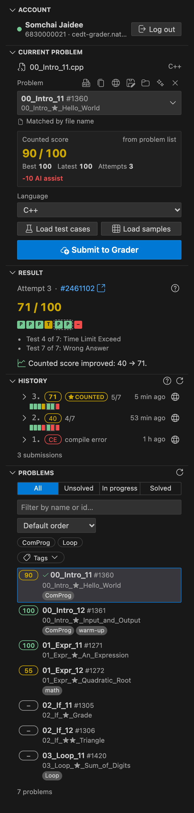
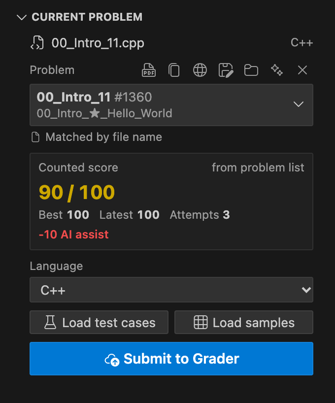
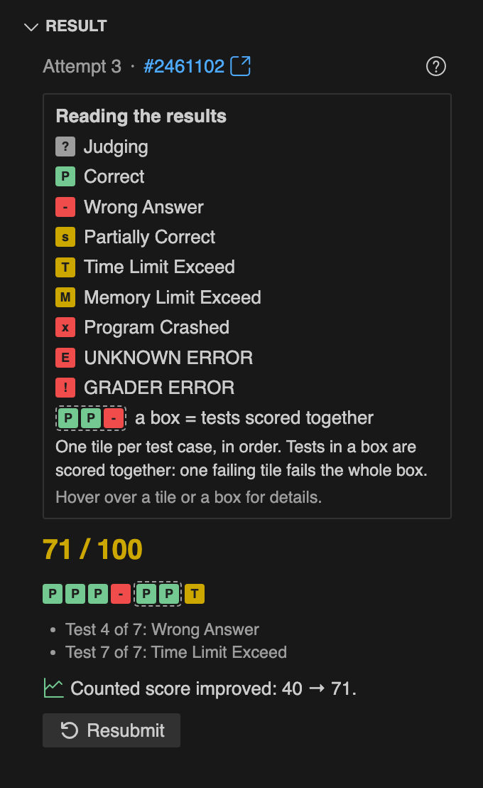
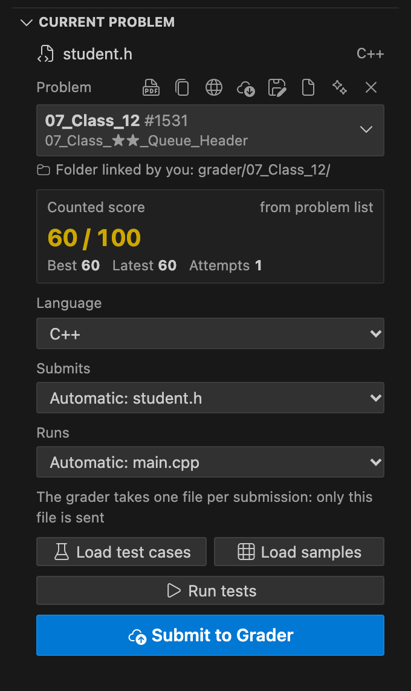
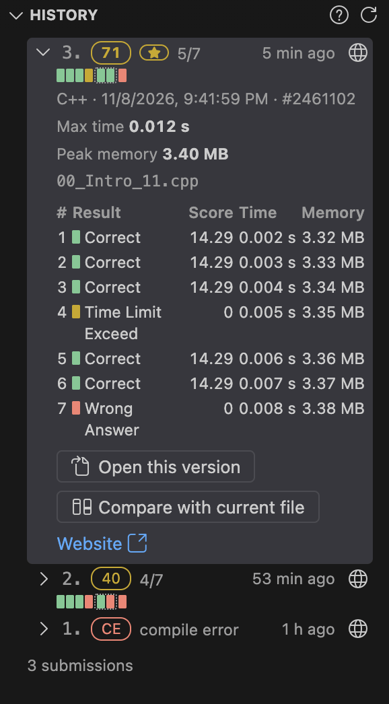
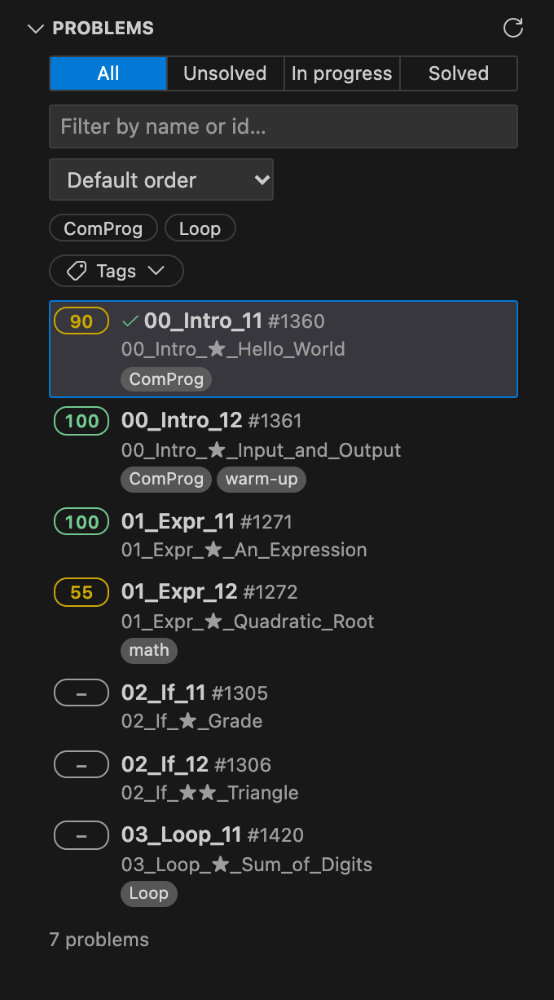
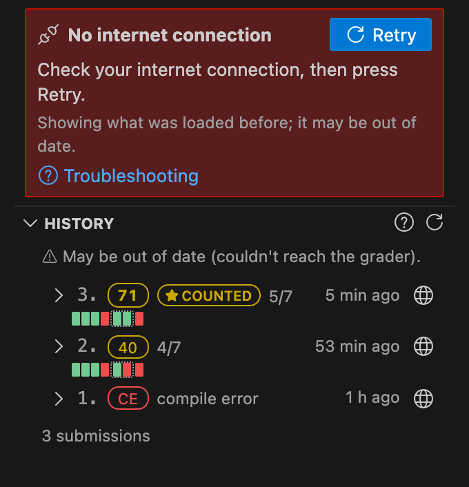
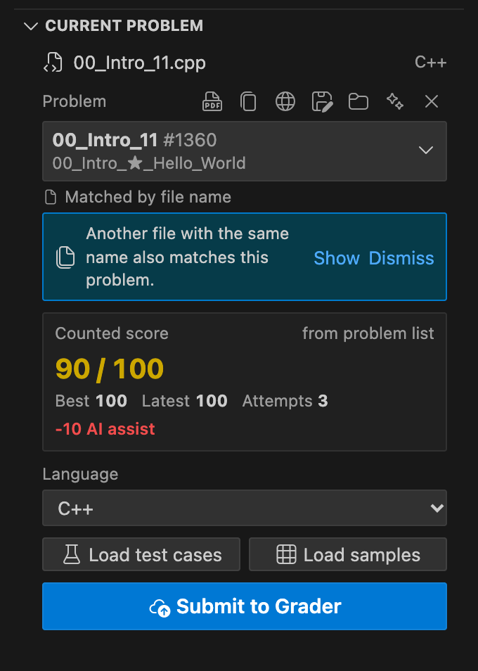

# Grader Submit

**English** · [ภาษาไทย](README.th.md)

**A fast, zero-clutter VS Code workflow for [cafe-grader-web](https://github.com/nattee/cafe-grader-web) servers — match problems, read PDF statements, run local test cases, and submit code from one sidebar.**

- **Built-in local test runner** — Download grader test cases or extract sample cases directly from the statement PDF, compile and run locally with side-by-side diffs, and keep your project folder 100% clean.
- **Instant problem matching & Folder Mode** — Files and multi-file packages (`main.cpp` + `student.h`) match automatically by file or folder name, including at the workspace root or outside a workspace.
- **Live scores, verdicts & Explorer badges** — Track your counted score (after hint/AI penalties), per-test verdicts, past submission diffs, Explorer file badges, and optional full-score celebrations.

> **Note:** This is an unofficial developer workflow extension. It is not made by the grader's maintainers.

  
  &nbsp;&nbsp;
  
   
  <em>The Grader panel in the Secondary Sidebar and the Current problem workflow with side-by-side test loading and local test execution.</em>

## Quickstart (< 60s)

Requires **VS Code 1.106 or newer**.

1. **Install:** Open **Extensions** (<kbd>Cmd</kbd>+<kbd>Shift</kbd>+<kbd>X</kbd> / <kbd>Ctrl</kbd>+<kbd>Shift</kbd>+<kbd>X</kbd>), search **Grader Submit** (`Badvoic3.cedt-grader-submit`), and click **Install** (or install a `.vsix` from [Releases](https://github.com/Badvoic3/cedt-grader-vscode/releases/latest)).
2. **Log in:** The **Grader** panel opens on the **right side** (Secondary Sidebar). Check `Server:` (click **✎** to use another `cafe-grader-web` address), enter your username and password, and click **Log in**.
3. **Open code:** Open your solution file (e.g. `00_Intro_11.cpp`) or an unzipped package folder. Files named like a problem match automatically; otherwise pick one under **Current problem**.
4. **Test locally:** Click **Load test cases** or **Load samples**, then press **Run tests** (or **Open tests** to inspect inputs, outputs, and diffs beside your code).
5. **Submit:** Press **Submit to Grader** to grade and see per-test verdicts and your updated counted score.

**Documentation:** [**User Guide (`USERGUIDE.md`)**](USERGUIDE.md) · [**Developer Guide (`DEVGUIDE.md`)**](DEVGUIDE.md) · [**Support (`SUPPORT.md`)**](SUPPORT.md) · [**Changelog (`CHANGELOG.md`)**](CHANGELOG.md)

---

## Feature Overview

| Feature | How It Works | Behavior / Shortcut |
|---|---|---|
| **Secondary Sidebar Panel** | Opens on the right side by default so your file Explorer stays visible on the left. | Drag the **Grader** header to move it anywhere; your placement is kept. In Cursor, it opens on the left. Controlled by `cedtGrader.panel.openOnStartup`. |
| **Account & Server Check** | Connects to `cedt-grader.nattee.net` by default or any compatible `cafe-grader-web` server. | Click **✎** on the `Server:` line before logging in to verify and switch servers, or click the **🌐** icon when logged in to open the website. |
| **Problem Matching** | Matches by your saved choice, exact file name, folder name, or a similarity suggestion. | Links are stored in VS Code's hidden storage (never littering your workspace). Click **✕** to unlink or **Auto-detect** to match again. |
| **Built-in Test Runner** | Compiles and runs `C++`, `C`, `Python`, `Java`, `Rust`, `Go`, `Haskell`, `Ruby`, `Pascal`, and `PHP` locally. | **Load test cases** fetches grader cases; **Load samples** reads the PDF example table. Open the **Tests** split view for diffs and custom cases. |
| **Folder Mode & Packages** | Links a multi-file folder (`main.cpp` + `student.h`) to one problem, including at the workspace root. | Automatically detects **Submits** (`student.h`) and **Runs** (`main.cpp`). **Download attachment** unpacks zip packages safely into a new linked folder. |
| **PDF Statements** | Renders problem PDFs (or Markdown descriptions) in a locked split tab beside your code. | Zoom, search (<kbd>Cmd</kbd>/<kbd>Ctrl</kbd>+<kbd>F</kbd>), and auto-follow the active file (`cedtGrader.statementFollowsFile`). Cached on disk for offline reading. |
| **Result & History** | Shows live grading status, per-test verdict tiles, group boxes, runtime, peak memory, and compiler output. | Expand any past submission in **History** for **Open this version** or **Compare with current file** in a VS Code diff editor. |
| **Problems & Filters** | Virtualized list of all course problems with counted scores, status tabs, 3-state topic pills, and tag filters. | Click a problem row to jump to its linked file, create a new file (`cedtGrader.fileNamePattern`), or download its attachment. |
| **Explorer Badges** | Decorates linked files and package folders in the Explorer and editor tabs. | Shows counted score (`✓`, `0`–`99`, `–`) or 2-letter topic tag (`cedtGrader.explorer.badge`) with status/tag colours (`cedtGrader.explorer.colors`). |
| **Celebrations, Trophies & Breaks** | Optional QoL extras (`cedtGrader.fun.*`) that never steal focus or delay grading. | Confetti + ring celebration on first full score, **Trophies** progress section, and a gentle break reminder with 5 interactive code scenes. |

  
  &nbsp;&nbsp;
  
   
  <em>Left: Per-test verdicts and grouped test scoring under Result. Right: Folder Mode with automatic Submits and Runs detection.</em>

  
  &nbsp;&nbsp;
  
   
  <em>Left: Submission history with 1-click diffing against your open file. Right: Problems list with status, topic, and tag filters.</em>

---

## Upgrading from v1.0.0

Grader Submit now includes its own **Built-in Test Runner** and stores all file links and test cases in VS Code's hidden storage (`globalStorageUri`).

- **Automatic import:** When you open a folder from `v1.0.0`, your existing `.cedt-grader.json` problem links and `.cph/*.prob` test cases are copied into hidden storage automatically.
- **One-click cleanup:** An inline prompt in the panel offers to move leftover `.cedt-grader.json`, `.cph/*.prob`, and compiled `.bin` files tied to this grader to your OS Trash. You can also trigger this anytime with **Grader: Clean Up Old Files** from the Command Palette.
- **Panel placement:** New installs open in the Secondary Sidebar on the right. If you had moved the panel in an earlier version, your placement is kept.

---

## Reference & Configuration

For step-by-step walkthroughs and annotated UI diagrams, see the [**User Guide (`USERGUIDE.md`)**](USERGUIDE.md).

<b>Settings Reference (<code>cedtGrader.*</code>)</b>

 

| Setting | Default | Description |
|---|---|---|
| `cedtGrader.displayLanguage` | `en` | Language of the panel, Test view, statement viewer, messages, and status bar: `en` (English), `th` (Thai), or `auto` (Follow VS Code). Command names and setting descriptions follow VS Code's own display language. |
| `cedtGrader.baseUrl` | `https://cedt-grader.nattee.net` | Base URL of the `cafe-grader-web` server (User Settings only, so a workspace cannot redirect your password). |
| `cedtGrader.username` | `""` | Your grader username (password is stored in OS keychain via VS Code `SecretStorage`). |
| `cedtGrader.panel.openOnStartup` | `true` | Open the Grader panel automatically when a window starts while keeping focus in your editor. |
| `cedtGrader.panel.sections` | all 6 | Sections shown and their order: `account`, `current`, `result`, `history`, `trophies`, `problems`. **Account** always appears while logged out. |
| `cedtGrader.panel.look` | `subtle` | Visual style across the panel, Test view, and statement viewer: `subtle` (short animations, sticky headers, raised cards, frosted menus/tooltips) or `plain`. |
| `cedtGrader.panel.compact` | `false` | Tighter spacing, single-line counted score and problem rows, and smaller verdict tiles. |
| `cedtGrader.panel.topicClickOrder` | `showFirst` | First click on a topic pill: `showFirst` (show only → hide → off) or `hideFirst` (hide → show only → off). |
| `cedtGrader.confirmBeforeSubmit` | `true` | Ask once before submitting an auto-matched file; submitting saves the match as your choice. |
| `cedtGrader.saveBeforeSubmit` | `true` | Save dirty files to disk before submitting so format-on-save runs first. |
| `cedtGrader.revealResultAfterSubmit` | `true` | Open and scroll to **Result** when grading finishes without stealing editor focus. |
| `cedtGrader.pollIntervalSeconds` | `5` | Seconds between grading checks (minimum `3`, stops after 3 minutes). |
| `cedtGrader.statementBeside` | `true` | Open problem statements in an editor group beside your code. |
| `cedtGrader.statementFollowsFile` | `true` | Switch an open statement tab to match the active source file's problem. |
| `cedtGrader.defaultLanguage` | `C++` | Fallback language for **New file for this problem**. |
| `cedtGrader.fileNamePattern` | `{name}.{ext}` | Pattern for **New file for this problem**, **Rename file to match the problem**, and auto-matching (`{name}`, `{id}`, `{ext}`). |
| `cedtGrader.runner.defaultTimeLimitSeconds` | `10` | Local test run time limit (seconds) when the grader does not specify one. |
| `cedtGrader.runner.defaultMemoryLimitMB` | `1024` | Local test run memory limit (MB, estimated on macOS/Linux) when the grader does not specify one. |
| `cedtGrader.runner.compilerPaths` | `{}` | Custom tool paths by executable name, e.g. `{ "g++": "/opt/homebrew/bin/g++-14" }`. |
| `cedtGrader.runner.extraCompileArgs` | `{}` | Extra compiler flags by language (`cpp`, `c`, `java`, `rust`, `go`, `haskell`). |
| `cedtGrader.explorer.badge` | `score` | Explorer badge on linked files: `score` (`✓`, `0`–`99`, `–`), `tag` (2-letter topic), or `off`. |
| `cedtGrader.explorer.colors` | `true` | Colour Explorer badges and file names by score status or topic tag. |
| `cedtGrader.fun.enabled` | `true` | Master toggle for first-full-score celebrations, **Trophies**, and break reminders. |
| `cedtGrader.fun.celebrate` | `true` | Play the celebration when a problem first passes every test or reaches 100. |
| `cedtGrader.fun.breakReminder` | `true` | Suggest a short break after a long coding stretch (status bar hint first, prompt only at a natural boundary). |
| `cedtGrader.fun.breakMinutes` | `90` | Active work minutes before the break hint appears (minimum `30`; a 10-minute idle gap resets the timer). |
| `cedtGrader.fun.breakScene` | `random` | Scene shown in the break tab: `random`, `sand`, `donut3d`, `donut2d`, `breathe`, or `swarm`. |
| `cedtGrader.cacheMaxMB` | `100` | Disk cache cap (MB, minimum `10`) for downloaded statements and grader test cases. |
| `cedtGrader.debugRequests` | `false` | Log HTTP method, path, status, and cache hit/miss to **Grader Submit: Requests** (never logs secrets). |

<b>Command Palette Commands (<code>Grader: …</code>)</b>

 

| Command | ID | What It Does |
|---|---|---|
| `Grader: Show Panel` | `cedtGrader.focus` | Focus the Grader sidebar panel. |
| `Grader: Log In` / `Grader: Log Out` | `cedtGrader.login` / `cedtGrader.logout` | Log in with saved credentials (or focus login form) / log out and clear stored credentials. |
| `Grader: Submit Current File` | `cedtGrader.submit` | Submit the active file (or folder's submit file) to the grader. |
| `Grader: Run Tests` / `Grader: Open Tests` | `cedtGrader.runTests` / `cedtGrader.openTests` | Compile and run local test cases / toggle the **Tests** split view. |
| `Grader: Load Test Cases from the Grader` | `cedtGrader.loadTestcases` | Download official test cases into the built-in runner. |
| `Grader: Load Sample Cases from the Statement` | `cedtGrader.loadSampleCases` | Extract example input/output cases from the statement PDF into the runner. |
| `Grader: Choose Problem for This File` | `cedtGrader.chooseProblem` | Link the active file (or folder) to a problem via Quick Pick. |
| `Grader: Clear Problem for This File` | `cedtGrader.clearMapping` | Unlink or stop auto-matching the active file or folder. |
| `Grader: Rename File to Match the Problem` | `cedtGrader.renameFileToProblem` | Rename the active file using `cedtGrader.fileNamePattern`. |
| `Grader: Switch Between Linking This File and the Whole Folder` | `cedtGrader.toggleFolderMode` | Toggle Folder Mode on or off for the current folder. |
| `Grader: Download Problem Attachment` | `cedtGrader.downloadAttachment` | Download and unpack the problem's template file or zip package. |
| `Grader: Open Problem Statement` | `cedtGrader.openStatement` | Open the problem statement PDF / Markdown tab beside your code. |
| `Grader: Show Last Result` | `cedtGrader.showLastResult` | Reveal the latest submission result in the panel. |
| `Grader: Reload Problem List` / `Reload Submission History` | `cedtGrader.refreshProblems` / `cedtGrader.refreshHistory` | Force-refresh the problem list or current problem's submission history. |
| `Grader: Take a Break` (+ 5 scene commands) | `cedtGrader.takeBreak` (`.sand`, `.donut3d`, `.donut2d`, `.breathe`, `.swarm`) | Open the 5-minute interactive break tab with a random or specific scene. |
| `Grader: Play Celebration` / `Grader: Show Trophies` | `cedtGrader.playCelebration` / `cedtGrader.showTrophies` | Replay the full-score celebration / open and focus the **Trophies** section. |
| `Grader: Clear Cached Data…` | `cedtGrader.clearCache` | Choose cached files, custom test cases, problem links, or saved login to clear. |
| `Grader: Clean Up Old Files` | `cedtGrader.cleanUpOldFiles` | Move legacy `.cedt-grader.json`, `.cph/*.prob`, and `.bin` files to the OS Trash. |
| `Grader: Open Settings` / `Grader: Show Request Log` | `cedtGrader.openSettings` / `cedtGrader.showRequestLog` | Open extension settings / open the `Grader Submit: Requests` output channel. |
| `Grader: How to Use` / `Grader: Troubleshooting` | `cedtGrader.openUserGuide` / `cedtGrader.openTroubleshooting` | Open `USERGUIDE.md` or the Troubleshooting section on GitHub in your display language. |

<b>Scores, Exams, Privacy & Storage</b>

 

- **Counted score:** Shows your best submission out of `100` minus hint/AI-assist penalties (or uncapped raw points on raw-sum problems). Your instructor's final grading rules may differ.
- **Exams:** If a problem list appears to be an exam, the extension warns you before submitting (**Open in Browser** / **Submit Anyway**). Always check with your instructor before using an extension during an exam.
- **Privacy & credentials:** Passwords and tokens are stored in your OS keychain (`SecretStorage`), never in settings or logs. Requests go only to `cedtGrader.baseUrl` (cross-origin redirects are blocked), and nothing is fetched while the panel is hidden.
- **Storage & uninstalling:** Statements, test cases, and file links live in VS Code's `globalStorageUri`; compiled test binaries live in `<os.tmpdir()>/cedt-grader-bin/`. Run **Grader: Clear Cached Data…** before uninstalling if you want to remove all cached data and keychain credentials.

---

## Troubleshooting

The panel links here from the logged-out **Account** section, the connection banner, and the panel's **⋯** menu (**Grader: Troubleshooting**). For detailed help and issue reporting, see [**`USERGUIDE.md#troubleshooting`**](USERGUIDE.md#troubleshooting) and [**`SUPPORT.md`**](SUPPORT.md).

  
  &nbsp;&nbsp;
  
   
  <em>Left: Offline banner keeping cached data accessible. Right: Notice when multiple files link to the same problem.</em>

| Problem | Cause & Fix |
|---|---|
| **Cannot log in (`Wrong username or password` / `Too many failed login attempts` / `refused`)** | Verify your credentials on the grader website. After repeated failures, the server blocks logins for a few minutes — wait before retrying. If using another server, click **✎** next to `Server:` in **Account** (or set `cedtGrader.baseUrl` in User Settings). |
| **`This address isn't a supported grader`** | The server check in **Account** verifies that the URL responds like a `cafe-grader-web` instance. Check for typos or click **Use the default server**. |
| **`The grader … sent the request on to another address`** | For security, redirects to a different host are blocked. If the grader moved to a new domain, update `cedtGrader.baseUrl` in User Settings. |
| **Wrong problem matched (or no problem matched)** | Click the problem box under **Current problem** to pick the right one (saved as **Chosen by you**), or click **✕** to unlink / stop auto-matching. |
| **`Run tests` says compiler not found or times out** | Install the compiler for your language (`g++`, `gcc`, `python3`, `javac`, `rustc`, `go`, `ghc`, `ruby`, `fpc`, `php`) or set its full path in `cedtGrader.runner.compilerPaths`. |
| **`Load samples` misses or misreads a PDF table** | Sample extraction reads selectable text inside ruled tables. Scanned PDFs or unusual layouts may be skipped or misread — check the cases in the **Tests** view or edit/add custom cases with **+ Add case**. |
| **Where is the Grader icon?** | In VS Code 1.106+, the **Grader** panel opens in the **Secondary Sidebar** on the right (run **Grader: Show Panel** from the Command Palette if hidden). Drag the **Grader** header to the left Activity Bar if you prefer it on the left. |

---

## License

[MIT](LICENSE)
