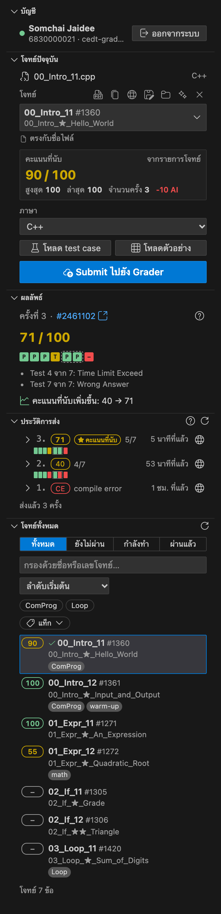
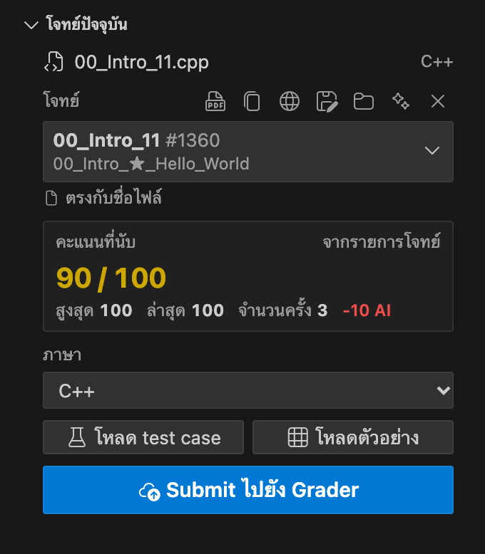
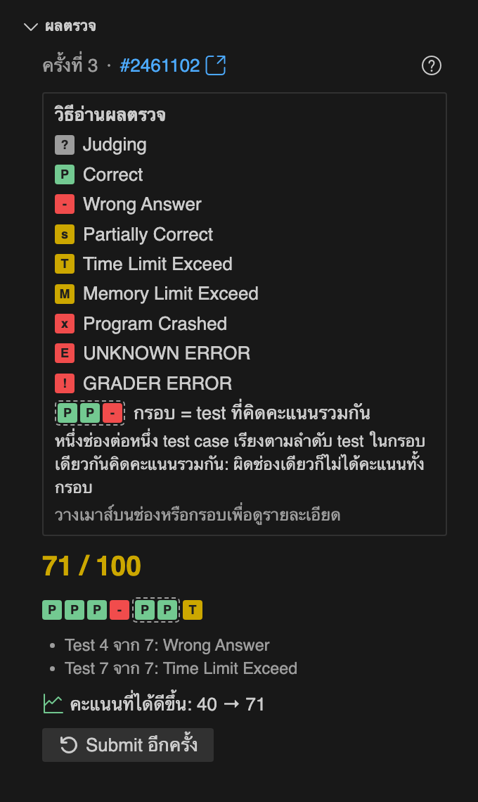
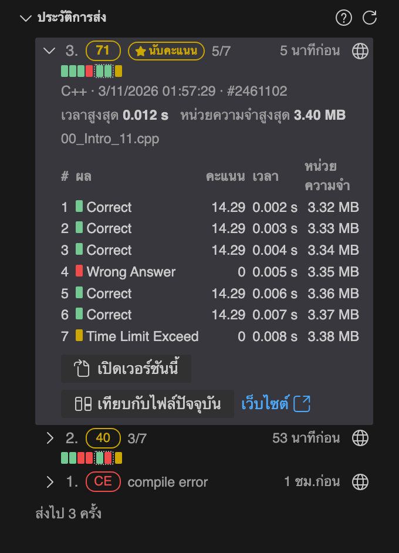
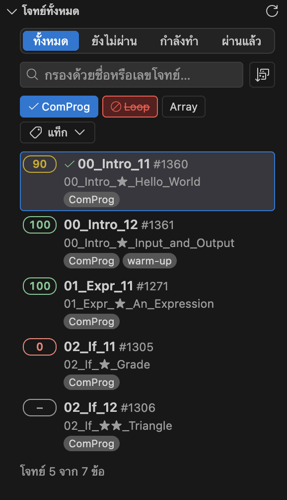
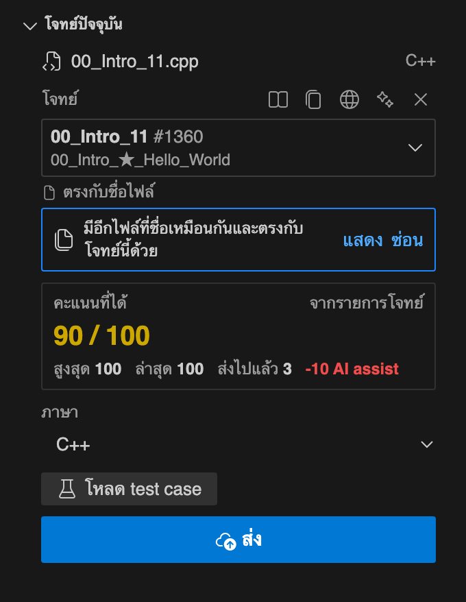
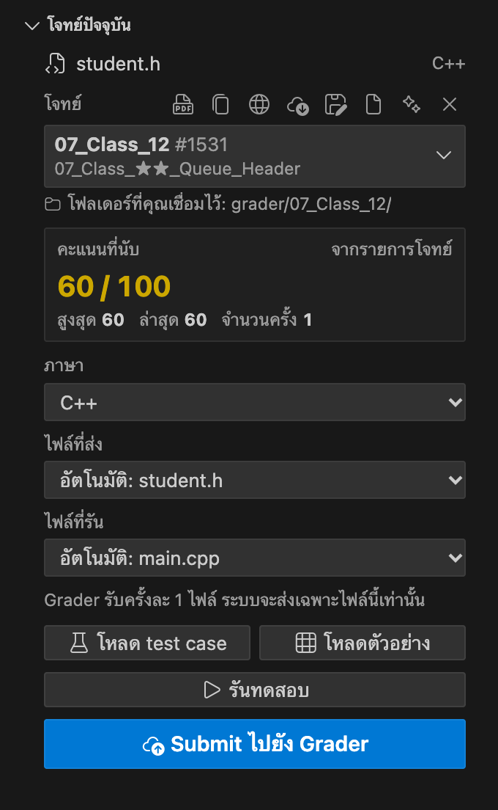
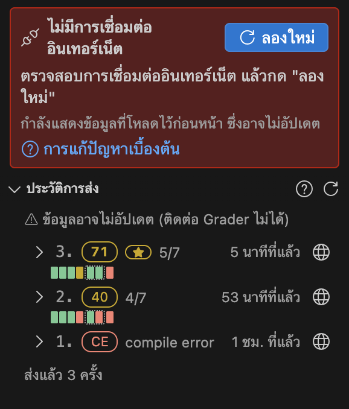

# CEDT Grader Submit

[English](README.md) · **ภาษาไทย**

ส่งไฟล์ที่คุณกำลังแก้ไขไปยัง **CEDT Grader** ([cedt-grader.nattee.net](https://cedt-grader.nattee.net) ซึ่งเป็นเซิร์ฟเวอร์ [cafe-grader-web](https://github.com/nattee/cafe-grader-web)) ได้ทันทีโดยไม่ต้องเปิดเบราว์เซอร์ แผงด้านข้างใน VS Code จะแสดงคะแนน ผลตรวจของแต่ละเคส ประวัติการส่ง รายการโจทย์ และตัวโจทย์ครบในที่เดียว

ส่วนขยายนี้เป็นเครื่องมืออย่างไม่เป็นทางการ ไม่ได้พัฒนาโดยผู้ดูแล Grader



- **Submit** ไฟล์ที่เปิดอยู่และดูผลตรวจรายเคสได้เหมือนบนหน้าเว็บ
- **คะแนนที่นับ:** คิดจากการส่งครั้งที่ได้คะแนนสูงสุด หักด้วยคะแนนที่ถูกหักจากคำใบ้และการใช้ AI
- **โจทย์ทั้งหมด** รวมอยู่ในรายการเดียว พร้อมตัวกรองตามสถานะ หัวข้อ และแท็ก
- **โจทย์ (Statement)** เปิดอ่านในแท็บข้างโค้ดของคุณได้ทันที
- **Test case:** โหลด test case จาก Grader หรืออ่านตัวอย่างจากโจทย์ มาเก็บเป็นไฟล์ `.in` / `.out` หรือนำเข้าสู่ CPH
- **ไฟล์แนบและโปรเจกต์:** ดาวน์โหลดไฟล์แนบของโจทย์และทำงานแบบทั้งโฟลเดอร์ (`main.cpp` + `student.h`)
- รองรับทั้งภาษาอังกฤษและภาษาไทย ([ภาษา](#ภาษา)) ใช้งานได้ในตัวโดยไม่จำเป็นต้องติดตั้ง [CPH](#การทำงานร่วมกับ-cph)

## การติดตั้ง

ต้องใช้ **VS Code 1.90 ขึ้นไป**

### ติดตั้งจาก Marketplace

1. เปิดแถบ Extensions: คลิกไอคอนสี่เหลี่ยมสี่ช่องบนแถบด้านซ้าย หรือกด <kbd>Ctrl</kbd>+<kbd>Shift</kbd>+<kbd>X</kbd> (<kbd>Cmd</kbd>+<kbd>Shift</kbd>+<kbd>X</kbd> บน macOS)
2. ค้นหา **CEDT Grader Submit** แล้วคลิก **Install** (รหัสส่วนขยายคือ `Badvoic3.cedt-grader-submit`)

ส่วนขยายจะอัปเดตให้โดยอัตโนมัติ

### ติดตั้งจากไฟล์ `.vsix`

ใช้วิธีนี้หากคุณไม่สามารถติดตั้งผ่าน Marketplace ได้

1. เปิดหน้า [รุ่นล่าสุด (latest release)](https://github.com/Badvoic3/cedt-grader-vscode/releases/latest) แล้วดาวน์โหลดไฟล์ `cedt-grader-submit-<version>.vsix` ในหัวข้อ *Assets* (ไม่ต้องแตกไฟล์ zip)
2. ในแถบ Extensions คลิกปุ่ม **⋯** (Views and More Actions) ด้านบน แล้วเลือก **Install from VSIX…** เลือกไฟล์ที่ดาวน์โหลดมา หาก VS Code ถามให้โหลดหน้าต่างใหม่ ให้คลิกตกลง

*หรือติดตั้งผ่านเทอร์มินัล:* รันคำสั่ง `code --install-extension cedt-grader-submit-<version>.vsix` ส่วนบน macOS หากไม่พบคำสั่ง `code` ให้รัน **Shell Command: Install 'code' command in PATH** จาก Command Palette (<kbd>Cmd</kbd>+<kbd>Shift</kbd>+<kbd>P</kbd>) ก่อน

### ตรวจสอบว่าติดตั้งสำเร็จ

ไอคอน **CEDT Grader** (รูปกระดาษที่มีเครื่องหมายถูก) จะปรากฏบนแถบด้านซ้าย หากคุณติดตั้งจากใน VS Code หน้า **Get started with CEDT Grader** (เริ่มต้นใช้งาน CEDT Grader) จะเปิดขึ้นมาโดยอัตโนมัติ คุณสามารถเปิดหน้านี้เมื่อไรก็ได้จากคำสั่ง **CEDT Grader: Get Started** (เริ่มต้นใช้งาน) ใน Command Palette หรือจากเมนู **⋯** ด้านบนของแผง

## ขั้นตอนแรกในการใช้งาน

1. คลิกไอคอน **CEDT Grader** บนแถบด้านซ้าย
2. เข้าสู่ระบบด้วยชื่อผู้ใช้และรหัสผ่านของ Grader เปิด **จำรหัสผ่านไว้ในเครื่องนี้** ทิ้งไว้ได้เลยถ้าเป็นคอมพิวเตอร์ส่วนตัวของคุณ
3. เปิดโฟลเดอร์ที่เก็บไฟล์คำตอบ (**File → Open Folder…**) แล้วเปิดไฟล์โค้ด เช่น `00_Intro_11.cpp`
4. ตรวจสอบโจทย์ในส่วน **โจทย์ปัจจุบัน** หากไฟล์ตั้งชื่อตรงกับโจทย์ ระบบจะจับคู่ให้อัตโนมัติ มิฉะนั้นให้คลิกเลือกโจทย์จากรายการ (ค้นหาด้วยชื่อหรือเลขโจทย์ได้) ระบบจะจำโจทย์ที่คุณเลือกไว้
5. กด **Submit ไปยัง Grader** ผลตรวจของแต่ละเคสและคะแนนที่นับจะแสดงขึ้นในแผงทันที

## ส่วนต่างๆ ของแผง

แผงแบ่งออกเป็น 5 ส่วน:

| ส่วน | สิ่งที่แสดง |
|---|---|
| **บัญชี** | เข้าสู่ระบบและออกจากระบบ ปุ่ม **ออกจากระบบ** จะล้างสถานะเข้าสู่ระบบและลบรหัสผ่านที่จำไว้ |
| **โจทย์ปัจจุบัน** | โจทย์ของไฟล์ที่กำลังแก้ไข คะแนนที่นับ ภาษา ปุ่มจัดการ test case และปุ่ม **Submit ไปยัง Grader** |
| **ผลลัพธ์** | ผลการส่งครั้งล่าสุด: สถานะสด คะแนนที่ได้ ช่องผลตรวจรายเคส และข้อความจากคอมไพเลอร์ |
| **ประวัติการส่ง** | ประวัติการส่งทุกครั้งของโจทย์ข้อนี้ รวมถึงครั้งที่ส่งผ่านหน้าเว็บ |
| **โจทย์ทั้งหมด** | รายการโจทย์ทั้งหมดของคุณพร้อมคะแนนที่นับ |

คุณสามารถซ่อนหรือเรียงลำดับส่วนต่างๆ ใหม่ และปรับแผงให้กะทัดรัดได้ (ดูที่ [การตั้งค่า](#การตั้งค่า))

### โจทย์ปัจจุบัน

แสดงชื่อไฟล์ โจทย์ที่เชื่อมอยู่ และวิธีที่ระบบจับคู่โจทย์ให้ (ในภาพคือ *ตรงกับชื่อไฟล์*) ตามด้วยคะแนนที่นับ ภาษาที่ใช้ส่ง และปุ่ม **Submit ไปยัง Grader**



ไอคอนข้างชื่อโจทย์:

- **เปิดโจทย์** (ไอคอน PDF), **คัดลอกชื่อโจทย์**, **เปิดบนเว็บ Grader**
- **ดาวน์โหลดไฟล์แนบ** แสดงเฉพาะโจทย์ที่มีไฟล์แนบให้ (ดูที่ [โหมดโฟลเดอร์และไฟล์แนบ](#โหมดโฟลเดอร์และไฟล์แนบ))
- **บันทึก test case จาก Grader เป็นไฟล์ .in / .out** แสดงเฉพาะโจทย์ที่มี test case ให้ดาวน์โหลด
- **เชื่อมทั้งโฟลเดอร์** / **เชื่อมเฉพาะไฟล์นี้**
- **ตรวจหาอัตโนมัติ** (ไอคอนประกายดาว) ค้นหาโจทย์ใหม่อีกครั้ง และปุ่ม **✕** สำหรับยกเลิกการเชื่อม

คลิกขวาที่ชื่อโจทย์เพื่อใช้คำสั่งเดียวกันนี้ รวมถึงคำสั่ง **เปลี่ยนชื่อไฟล์ให้ตรงกับโจทย์**

ช่องเลือกภาษาจะแสดงเฉพาะภาษาที่โจทย์อนุญาตเท่านั้น หากโจทย์ไม่รับภาษาของไฟล์ที่เปิดอยู่ แผงจะแจ้งว่า "โจทย์นี้ไม่รับภาษา C++ เลือกโจทย์ผิดหรือเปล่า?" พร้อมปุ่ม **เปลี่ยน**

### ผลลัพธ์

ขณะกำลังตรวจ แผงจะแสดงสถานะสดให้เห็น เมื่อตรวจเสร็จแล้วจะแสดงคะแนน ช่องผลตรวจรายเคสสีต่างๆ เหมือนบนหน้าเว็บ ข้อความจากคอมไพเลอร์หากคอมไพล์ไม่ผ่าน และแจ้งว่าคะแนนที่นับของคุณเพิ่มขึ้นหรือไม่



**วิธีอ่านผลตรวจ:** แต่ละช่องเรียงตามลำดับเคส สีเขียว P = ผ่าน (Correct), สีแดง - = คำตอบผิด (Wrong Answer), สีเหลือง T = เกินเวลา (Time Limit Exceed) เป็นต้น เคสที่อยู่ในกรอบเส้นประเดียวกันจะคิดคะแนนร่วมกัน หากไม่ผ่านแม้แต่ช่องเดียวจะไม่ได้คะแนนทั้งกรอบ ชี้ที่ช่องหรือกรอบเพื่อดูรายละเอียดได้ และกดปุ่ม **?** เพื่อเปิดคำอธิบายนี้

### ประวัติการส่ง

คลิกที่รายการส่งงานเพื่อดูผลตรวจรายเคส เวลาที่ใช้ และหน่วยความจำ กด **เปิดเวอร์ชันนี้** เพื่อเปิดดูโค้ดที่ส่งในครั้งนั้นในเอดิเตอร์ใหม่ หรือกด **เทียบกับไฟล์ปัจจุบัน** เพื่อดูจุดที่แตกต่าง สัญลักษณ์ดาวแสดงถึงการส่งครั้งที่ถูกนำมาคิดเป็นคะแนนที่นับ



### โจทย์ทั้งหมด

แสดงโจทย์ทุกข้อพร้อมคะแนนที่นับทางซ้ายและแท็กของโจทย์ เครื่องหมาย "–" สีเทาหมายถึงยังไม่เคยส่ง และเครื่องหมาย ✓ แสดงโจทย์ของไฟล์ที่กำลังเปิดอยู่



- **สถานะ:** ทั้งหมด / ยังไม่ผ่าน / กำลังทำ / ผ่านแล้ว เหมือนบนหน้าเว็บ
- **หัวข้อ:** คลิกปุ่มหัวข้อ 1 ครั้งเพื่อแสดงเฉพาะโจทย์ในหัวข้อนั้น คลิกซ้ำเพื่อซ่อน และคลิกครั้งที่สามเพื่อปิดตัวกรอง เลือกพร้อมกันได้หลายหัวข้อ หากต้องการให้คลิกครั้งแรกเป็นการ "ซ่อน" ก่อน สามารถปรับได้ที่การตั้งค่า `cedtGrader.panel.topicClickOrder`
- **แท็ก:** เมนู **แท็ก** แสดงแท็กอื่นๆ ของโจทย์ ติ๊กเลือกได้หลายแท็กพร้อมกำหนดเงื่อนไข **อย่างน้อยหนึ่งแท็ก (OR)** หรือ **ครบทุกแท็ก (AND)**
- **ค้นหา** ด้วยชื่อหรือเลขโจทย์ และ **เรียงลำดับ** (ลำดับเริ่มต้น, ชื่อ A–Z, ชื่อ Z–A, ส่งล่าสุด, คะแนนสูงสุด (น้อยไปมาก / มากไปน้อย), เปิดดูล่าสุด)

คลิกที่โจทย์เพื่อเปิดไฟล์ที่เชื่อมไว้ หากยังไม่มีไฟล์ คุณสามารถเชื่อมกับไฟล์ที่เปิดอยู่ สร้างไฟล์ใหม่ ค้นหาไฟล์ที่ตรงกับโจทย์ หรือเปิดอ่านโจทย์ได้ เมื่อชี้ที่แถวโจทย์ (หรือเลื่อนไปที่แถวนั้นด้วยคีย์บอร์ด) จะมีไอคอนทางลัดปรากฏขึ้น ได้แก่ **คัดลอกชื่อโจทย์**, **ไปที่ไฟล์ที่เชื่อมไว้** หรือ **ค้นหาไฟล์ที่ตรงกับโจทย์**, **สร้างไฟล์ใหม่สำหรับโจทย์นี้**, **เปิดโจทย์** และ **ดาวน์โหลดไฟล์แนบ** (ถ้ามี) คลิกขวาที่แถวเพื่อดูคำสั่งทั้งหมด สำหรับคีย์บอร์ด ใช้ปุ่ม ↑ / ↓ / Home / End เพื่อเลื่อนดูโจทย์ และกด Tab เพื่อไปยังไอคอนในแถวนั้น

รายการโจทย์จะจำตำแหน่งการเลื่อนหน้าจอไว้เสมอ

## การเชื่อมไฟล์กับโจทย์

**จับคู่ให้อัตโนมัติ** ไฟล์ที่ตั้งชื่อตรงกับชื่อโจทย์จะถูกเชื่อมเข้ากับโจทย์นั้นทันที (`00_Intro_11.cpp` → `00_Intro_11`) โดยไม่สนตัวพิมพ์เล็ก-ใหญ่ ช่องว่าง `-`, `_` และ `.` ส่วนไฟล์ที่อยู่ในโฟลเดอร์ซึ่งตั้งชื่อตามโจทย์ก็จะถูกจับคู่กับโจทย์นั้นเช่นกัน ("ตรงกับชื่อโฟลเดอร์")

**คำแนะนำโจทย์** ไฟล์ที่มีชื่อ *ใกล้เคียง* กับโจทย์ข้อใดข้อหนึ่งจะแสดงเป็นคำแนะนำ: "แนะนำจากชื่อไฟล์ · **ใช้โจทย์นี้**" คุณสามารถดูคะแนน ประวัติการส่ง และอ่านโจทย์ได้ทันที และเมื่อกดส่งหรือโหลด test case ระบบจะถามยืนยันก่อน 1 ครั้ง หากมีหลายโจทย์ที่ชื่อใกล้เคียงพอๆ กัน แผงจะถามให้คุณเลือก

**ยึดตามโจทย์ที่คุณเลือกเสมอ** โจทย์ที่คุณเลือกเองจะถูกบันทึกไว้ในไฟล์ `.cedt-grader.json` ในโฟลเดอร์งานและในพื้นที่เก็บข้อมูลของ VS Code บรรทัดใต้ชื่อโจทย์จะแสดงที่มาของการเชื่อม ได้แก่ **คุณเลือกเอง**, **ตรงกับชื่อไฟล์**, **ตรงกับชื่อโฟลเดอร์**, **ตรงกับข้อมูล CPH** หรือ **แนะนำ**

**การส่งงาน** สำหรับไฟล์ที่ระบบจับคู่โจทย์ให้อัตโนมัติ ระบบจะถามยืนยันเพียงครั้งเดียวในการส่งครั้งแรก หลังจากนั้นสถานะจะเปลี่ยนเป็น "คุณเลือกเอง" และปุ่ม **Submit ไปยัง Grader** ในครั้งถัดไปจะส่งงานทันที คำถามยืนยันก่อนส่งจะปรากฏอยู่เหนือปุ่มส่งโดยตรง

**ปุ่ม ✕ ข้างชื่อโจทย์** ใช้ได้ทุกกรณี: แสดงเป็น **ยกเลิกการเชื่อมไฟล์นี้** สำหรับโจทย์ที่คุณเลือกเอง และ **ไม่ต้องจับคู่ไฟล์นี้** สำหรับโจทย์ที่จับคู่อัตโนมัติ (หรือ **ยกเลิกการเชื่อมโฟลเดอร์นี้** / **ไม่ต้องจับคู่โฟลเดอร์นี้** ในโหมดโฟลเดอร์) ไม่ว่าจะกรณีใด ระบบจะไม่ยุ่งกับไฟล์นั้นอีกจนกว่าคุณจะเลือกโจทย์ใหม่หรือกด **ตรวจหาอัตโนมัติ**

**เปลี่ยนชื่อไฟล์ให้ตรงกับโจทย์** เปลี่ยนชื่อไฟล์ เช่น `sol.cpp` ให้เป็น `00_Intro_11.cpp` โดยคุณแก้ไขชื่อก่อนตกลงได้ คำสั่งนี้จะไม่เขียนทับไฟล์ที่มีอยู่แล้ว รองรับการกด Undo และย้ายทั้งการเชื่อมรวมถึง test case ใน CPH ตามไปให้ด้วย

**มีหลายไฟล์เชื่อมกับโจทย์เดียวกัน** หากมีไฟล์ตั้งแต่ 2 ไฟล์ขึ้นไปที่เชื่อมกับโจทย์ข้อเดียวกัน (เช่น ไฟล์ทดลองเขียน หรือไฟล์ชื่อซ้ำกันในคนละโฟลเดอร์) แผงจะแจ้งเตือนและแสดงรายการไฟล์เหล่านั้นพร้อมปุ่ม **เปิด** และ **ยกเลิกการเชื่อม** กด **ปิด** เพื่อซ่อนแจ้งเตือนจนกว่าไฟล์จะมีการเปลี่ยนแปลง และก่อนที่คุณจะกดส่ง หากอีกไฟล์เพิ่งถูกแก้ไขใหม่กว่า ระบบจะถามยืนยันก่อน



**การย้ายไฟล์** การเปลี่ยนชื่อหรือย้ายไฟล์ที่เชื่อมไว้ภายใน VS Code จะคงการเชื่อมเดิมไว้เสมอ หากคุณย้ายไฟล์นอก VS Code (เช่น ใน Finder หรือผ่าน git) แผงจะถามว่าจะคงการเชื่อมเดิมไว้หรือไม่เมื่อคุณเปิดไฟล์นั้น

## โหมดโฟลเดอร์และไฟล์แนบ

โจทย์บางข้อแจกมาเป็นโปรเจกต์ซึ่งประกอบด้วยไฟล์ `main.cpp` ที่ใช้รันทดสอบ และไฟล์ที่คุณต้องเขียนโค้ดเอง เช่น `student.h` โหมดโฟลเดอร์จะช่วยให้คุณเชื่อมทั้งโฟลเดอร์เข้ากับโจทย์ข้อนั้นได้



**การดาวน์โหลดไฟล์แนบ** สำหรับโจทย์ที่มีไฟล์แนบ (ปุ่ม "File" บนหน้าเว็บ) ให้คลิก **ดาวน์โหลดไฟล์แนบ** ในส่วนโจทย์ปัจจุบันหรือในแถวของโจทย์นั้น ระบบจะดาวน์โหลดเฉพาะเมื่อคุณคลิกเท่านั้น

- **กรณีเป็นไฟล์เดี่ยว** ระบบจะบันทึกไฟล์ไว้ข้างไฟล์ของคุณโดยใช้ชื่อเดิมและเปิดขึ้นมาให้ พร้อมเสนอให้เปลี่ยนชื่อไฟล์ให้ตรงกับโจทย์
- **กรณีเป็นไฟล์แพ็กเกจ zip** ระบบจะตรวจสอบความปลอดภัยก่อน แล้วจึงแตกไฟล์ลงในโฟลเดอร์ **ใหม่** โดยคุณเลือกได้ว่าจะ **ตั้งชื่อตามโจทย์ (`<ชื่อโจทย์>/`) และเชื่อมกับโจทย์** เพื่อเริ่มใช้งานโหมดโฟลเดอร์ทันที หรือ **ใช้ชื่อเดิม (`<ชื่อเดิม>/`) โดยไม่ต้องเชื่อม**
- ไม่มีการเขียนทับไฟล์ที่มีอยู่แล้วเด็ดขาด ไฟล์ zip ที่มีพาธไม่ปลอดภัย มีไฟล์เกิน 500 ไฟล์ หรือมีขนาดรวมเกิน 50 MB จะถูกปฏิเสธ ส่วนไฟล์ขยะของ macOS โฟลเดอร์ซ่อนอย่าง `.git` และไฟล์โปรแกรมที่คอมไพล์แล้วจะถูกข้ามไป

**เชื่อมโฟลเดอร์ด้วยตัวเอง** คลิกไอคอน **เชื่อมทั้งโฟลเดอร์** ข้างชื่อโจทย์ และคลิก **เชื่อมเฉพาะไฟล์นี้** เมื่อต้องการสลับกลับ

**ไฟล์ที่ส่ง (Submits) และ ไฟล์ที่รัน (Runs)** ในโหมดโฟลเดอร์ แผงจะค้นหาไฟล์ทั้งสองหน้าที่ให้เองโดยอัตโนมัติ:

- **ไฟล์ที่ส่ง:** ไฟล์ที่จะถูกส่งไปยัง Grader เช่น `student.h` เพราะ Grader รับครั้งละ 1 ไฟล์และใช้ `main` ของฝั่งเซิร์ฟเวอร์เองในการตรวจ
- **ไฟล์ที่รัน:** โปรแกรมที่ใช้รันทดสอบ เช่น `main.cpp` ที่มีฟังก์ชัน `main()`

เมนูแต่ละช่องจะเริ่มต้นด้วย "อัตโนมัติ: <ชื่อไฟล์>" คุณสามารถชี้ดูเหตุผลที่ระบบเลือกไฟล์นั้น หรือคลิกเลือกไฟล์อื่นเองได้ ซึ่งระบบจะบันทึกไว้คู่กับการเชื่อมโฟลเดอร์ หากคุณเปิดไฟล์อื่นในโฟลเดอร์ไว้ตอนกดส่ง แผงจะถามยืนยัน 1 ครั้งว่าจะ "Submit student.h" หรือ "Submit main.cpp (ไฟล์ที่เปิดอยู่)"

**Test case ในโหมดโฟลเดอร์** จะไปที่ไฟล์ที่รันเสมอ เมื่อติดตั้ง CPH แล้ว การกดปุ่ม **รันทดสอบ** จะบันทึกไฟล์ทั้งหมดในโฟลเดอร์และสั่งรันทดสอบใน CPH ให้ทันที นอกจากนี้ `main` ของ Grader พิมพ์บรรทัดสุดท้ายเพิ่มขึ้นมาเป็น `KEY: …` ซึ่งไม่มีใน `main.cpp` ที่แจกให้นักศึกษา ส่วนขยายจึงตัดบรรทัดนี้ออกจากผลลัพธ์ที่คาดหวังให้โดยอัตโนมัติ

โฟลเดอร์ที่ตั้งชื่อตรงกับโจทย์จะทำงานแบบเดียวกันโดยอัตโนมัติ ("ตรงกับชื่อโฟลเดอร์") ทั้งไฟล์ที่ส่งและไฟล์ที่รันจะถูกค้นหาให้เอง ทั้งนี้ข้อมูลการเชื่อมโฟลเดอร์จะบันทึกแยกตามโฟลเดอร์ของ workspace ดังนั้นโฟลเดอร์ที่กดเชื่อมไว้ในหน้าต่าง VS Code หนึ่งจะไม่ได้เชื่อมตามเมื่อเปิดจากโฟลเดอร์แม่ในอีกหน้าต่างหนึ่ง ซึ่งการจับคู่จากชื่อโฟลเดอร์จะช่วยในกรณีนี้

## Test case และตัวอย่างจากโจทย์

ปุ่ม **โหลด test case** จะดาวน์โหลด test case จาก Grader (เฉพาะโจทย์ที่เปิดให้ดาวน์โหลด) ส่วนเคสขนาดใหญ่ที่ Grader แสดงเพียงบางส่วนจะถูกข้ามไป

- **หากไม่ได้ติดตั้ง CPH** ในครั้งแรกที่กด ระบบจะถามว่าจะเก็บไว้ที่ไหนระหว่าง **บันทึกเป็นไฟล์** หรือ **ติดตั้ง CPH** หากเลือกบันทึกเป็นไฟล์ ระบบจะเก็บไว้ที่ `<ชื่อโจทย์>/tests/1.in`, `1.out`, … ข้างไฟล์ source ของคุณ โดยจะถามก่อนสร้างโฟลเดอร์และไม่เขียนทับไฟล์เดิมของคุณเด็ดขาด
- **หากติดตั้ง CPH แล้ว** ระบบจะนำเข้าสู่ CPH ทันที (ดูที่ [การทำงานร่วมกับ CPH](#การทำงานร่วมกับ-cph))
- ไอคอน **บันทึก test case จาก Grader เป็นไฟล์ .in / .out** ข้างชื่อโจทย์จะบันทึกเป็นไฟล์เสมอแม้ว่าจะติดตั้ง CPH ไว้ก็ตาม

ปุ่ม **โหลดตัวอย่าง** ใช้ได้กับโจทย์ทุกข้อ โดยจะอ่านตารางตัวอย่างอินพุต/เอาต์พุตจากไฟล์ PDF ของโจทย์ แล้วบันทึกในรูปแบบเดียวกัน คือเข้าสู่ CPH หรือบันทึกเป็นไฟล์ `tests/sample1.in`, `sample1.out`, … เคสที่มีอยู่แล้วจะถูกข้ามไป หากตารางใน PDF มีรูปแบบซับซ้อนอาจอ่านคลาดเคลื่อนได้ จึงควรตรวจสอบเคสอีกครั้ง หากมีแถวใดในตารางที่อ่านไม่ได้ ระบบจะไม่โหลดตัวอย่างและแจ้งให้คุณทราบ ฟีเจอร์นี้รองรับตารางที่มีเส้นแบ่งและเลือกข้อความได้ (ไม่รองรับหน้ากระดาษที่สแกนเป็นรูปภาพ)

## การอ่านโจทย์ (Statement)

คลิกไอคอน PDF (**เปิดโจทย์**) เพื่อเปิดอ่านโจทย์ในแท็บด้านข้างโค้ดของคุณ

- ซูมเข้า-ออกด้วยการจีบนิ้วบนแทร็กแพด หรือกด <kbd>Cmd</kbd>/<kbd>Ctrl</kbd> <kbd>+</kbd> / <kbd>-</kbd> กด <kbd>Cmd</kbd>/<kbd>Ctrl</kbd> <kbd>0</kbd> เพื่อปรับให้พอดีความกว้าง และค้นหาข้อความด้วย <kbd>Cmd</kbd>/<kbd>Ctrl</kbd>+<kbd>F</kbd>
- แท็บโจทย์จะจำหมายเลขหน้าและระดับการซูมไว้ และเปิดกลับมาที่เดิมเมื่อเปิด VS Code ใหม่
- ไฟล์โจทย์จะดาวน์โหลดเพียงครั้งเดียวและเก็บไว้ในพื้นที่ของ VS Code โดยไม่ปะปนในโฟลเดอร์โปรเจกต์ของคุณ กดปุ่มรีเฟรชในหน้าดูโจทย์ได้หากต้องการดาวน์โหลดใหม่
- โจทย์ที่ไม่มีไฟล์ PDF จะแสดงคำอธิบายแบบข้อความแทน
- แท็บโจทย์ที่เปิดอยู่จะเปลี่ยนตามไฟล์ที่คุณกำลังดู เมื่อสลับไปที่ไฟล์คำตอบอื่น แท็บจะเปลี่ยนไปแสดงโจทย์ของไฟล์นั้นทันที (ปิดพฤติกรรมนี้ได้ที่การตั้งค่า `cedtGrader.statementFollowsFile`)

## วิธีอื่นๆ ในการส่งงาน

- รายการบนแถบสถานะด้านล่าง (☁ **Submit ไปยัง Grader** พร้อมแสดงคะแนนหลังตรวจเสร็จ) คลิกเพื่อเปิดแผงได้
- ปุ่ม ☁ บนแถบหัวเรื่องของเอดิเตอร์ (สำหรับไฟล์ C, C++, Python และ Java) ใช้กดส่งไฟล์ปัจจุบันได้ทันที
- ทุกการทำงานมีอยู่ใน Command Palette (`CEDT Grader: …`) จึงสามารถตั้งคีย์ลัดได้ตามต้องการ ได้แก่: Log In, Log Out, Submit Current File, Choose Problem for This File, Clear Problem for This File, Rename File to Match the Problem, Load Test Cases from the Grader, Save Test Cases as .in / .out Files, Load Sample Cases from the Statement, Run Tests, Download Problem Attachment, Switch Between Linking This File and the Whole Folder, Show Last Result, Open Problem Statement, Reload Problem List, Reload Submission History, Show Panel, Open Settings, Show Request Log, Clear Cached Data…, Get Started, Troubleshooting

## การทำงานร่วมกับ CPH

[Competitive Programming Helper](https://marketplace.visualstudio.com/items?itemName=DivyanshuAgrawal.competitive-programming-helper) (CPH) ช่วยรัน test case บนเครื่องของคุณเอง CPH เป็นตัวเลือกเสริม ฟีเจอร์อื่นๆ ทั้งหมดทำงานได้โดยไม่ต้องมี CPH แต่หากคุณติดตั้ง CPH ไว้:

- ปุ่ม **โหลด test case** และ **โหลดตัวอย่าง** จะบันทึกเคสต่างๆ เข้าสู่ข้อมูลโจทย์ CPH ของไฟล์นั้น ("บันทึกลง CPH แล้ว") โดยเคสที่คุณสร้างไว้เองใน CPH จะอยู่ด้านบนสุด สำรองไฟล์ CPH เดิมไว้ให้ (`.bak`) และการกดโหลดซ้ำจะไม่เพิ่มเคสที่ซ้ำกัน
- CPH จะอ่านเคสชุดใหม่เมื่อคุณสลับไปที่ไฟล์นั้น หากไฟล์นั้นเปิดอยู่ด้านหน้าอยู่แล้ว ส่วนขยายจะจัดการรีโหลดให้เอง มิฉะนั้นให้กด **โหลดใหม่ใน CPH** (หรือสลับไปที่ไฟล์นั้น) ก่อนสั่งรัน
- ปุ่ม **รันทดสอบ** (ในโหมดโฟลเดอร์ หรือในไฟล์ที่มีเคสใน CPH) จะสั่งรันเคสเหล่านั้นใน CPH ทันที
- **การจับคู่โจทย์:** ไฟล์ที่ข้อมูล CPH อ้างอิงถึงโจทย์บน Grader (จาก URL หรือชื่อโจทย์) จะถูกเชื่อมกับโจทย์นั้นโดยอัตโนมัติ ("ตรงกับข้อมูล CPH")
- **การเปลี่ยนชื่อไฟล์:** หลังจากที่คุณเปลี่ยนชื่อไฟล์หรือโฟลเดอร์ใน VS Code ส่วนขยายจะเสนอให้ย้าย test case ใน CPH ตามไปด้วย (เนื่องจาก CPH เองไม่ได้ย้ายไฟล์ตามเมื่อเปลี่ยนชื่อ)
- **ปัญหาแผง CPH เปิดทับแผงนี้:** โดยปกติ CPH จะเปิดแผงของตัวเองทุกครั้งที่คุณสลับไปที่ไฟล์ source (จากการตั้งค่า "Auto Show Judge" ของ CPH) แผงของเราจะถามคุณ 1 ครั้งว่าต้องการปิดพฤติกรรมนั้นไหม โดยเลือกได้ระหว่าง **ปิดไว้**, **คงไว้ตามเดิม** หรือ **ไม่ต้องถามอีก** ทั้งนี้คุณยังเปิดแผง CPH เองได้ตามปกติ
- ทั้งสองส่วนขยายจะมีปุ่มอยู่บนแถบหัวเรื่องของเอดิเตอร์ โดยปุ่มของ CPH ใช้รันทดสอบบนเครื่อง ส่วนปุ่มของเรา (☁) ใช้ส่งโค้ดไปยัง Grader

ส่วนขยายนี้ไม่ดัดแปลงตัว CPH และไม่บังคับว่าต้องติดตั้ง หากไม่มี CPH ระบบจะบันทึก test case เป็นไฟล์แทน

## เมื่อการเชื่อมต่อขัดข้อง

แบนเนอร์ด้านบนสุดของแผงจะแจ้งสาเหตุที่เกิดปัญหา (ไม่มีอินเทอร์เน็ต เซิร์ฟเวอร์มีปัญหา การเข้าสู่ระบบหมดอายุ พยายามเข้าสู่ระบบมากเกินไป หรือหมดเวลาเชื่อมต่อ) พร้อมปุ่ม **ลองใหม่** ข้อมูลที่โหลดไว้ก่อนหน้าจะยังแสดงอยู่โดยมีข้อความกำกับว่า "ข้อมูลอาจไม่อัปเดต" หากส่งงานไปแล้วก่อนเน็ตหลุด ระบบจะโหลดผลตรวจให้อัตโนมัติเมื่อกลับมาเชื่อมต่อได้อีกครั้ง



## การคิดคะแนน

แผงจะแสดง **คะแนนที่นับ** ของ Grader ซึ่งคิดจากการส่งครั้งที่ได้คะแนนสูงสุดของคุณ ไม่ใช่ครั้งล่าสุด

- คะแนนเต็มคือ 100 โดย Grader จะปรับสเกลโจทย์ปกติทุกข้อให้เต็ม 100 ไม่ว่าจะมีกี่ test case ก็ตาม
- โจทย์ที่คิดคะแนนแบบรวมคะแนนดิบ ("คิดคะแนนรวมดิบ") จะแสดงผลรวมคะแนนดิบโดยไม่มีคะแนนเต็มตายตัว
- คะแนนที่ถูกหักจากคำใบ้และการใช้ AI (เช่น "-10 AI") จะถูกนำมาหักออกเหมือนในหน้ารายการโจทย์บนเว็บ โดยอ่านข้อมูลจากหน้ารายการโจทย์ของเว็บไซต์ หากแผงไม่สามารถอ่านหน้านั้นได้ (เช่น คุณไม่ได้เปิดให้จำรหัสผ่านไว้และเซสชันของเว็บไซต์หมดอายุแล้ว) แผงจะแสดงคะแนนสูงสุดโดยไม่หักคะแนนพร้อมแจ้งให้ทราบ
- หากการส่งครั้งล่าสุดได้คะแนนน้อยกว่าเดิม แผงจะแจ้งให้ทราบทันที ("ครั้งล่าสุด: 40 ระบบยังนับคะแนนสูงสุดของคุณคือ 70")
- ไม่ได้นำกฎการคิดคะแนนเฉพาะช่วงเวลาสอบ (contest-window) มาคำนวณ

ส่วนขยายนี้แสดงข้อมูลตามที่ Grader แสดงเท่านั้น **คะแนนสุดท้ายที่อาจารย์ผู้สอนให้อาจแตกต่างจากนี้**

## การใช้งานในการสอบ

ส่วนขยายนี้เป็นเครื่องมือช่วยทำการบ้านอย่างไม่เป็นทางการ หากโจทย์ดูเหมือนเป็นส่วนหนึ่งของการสอบ ส่วนขยายจะแจ้งเตือนก่อนส่ง (**เปิดในเบราว์เซอร์** / **ยืนยันที่จะ Submit**) โปรดสอบถามอาจารย์ผู้สอนก่อนใช้งานในการสอบ

## การตั้งค่า

| การตั้งค่า | ค่าเริ่มต้น | คำอธิบาย |
|---|---|---|
| `cedtGrader.displayLanguage` | `en` | ภาษาของแผงและข้อความแจ้งเตือน: English, ไทย (Thai) หรือ ตามภาษาของ VS Code (Follow VS Code) ดูที่ [ภาษา](#ภาษา) |
| `cedtGrader.panel.sections` | แสดงทั้งหมดตามลำดับ | เลือกส่วนของแผงที่ต้องการแสดงและลำดับการแสดงผล (บัญชี, โจทย์ปัจจุบัน, ผลลัพธ์, ประวัติการส่ง, โจทย์ทั้งหมด) ลบรายการออกเพื่อซ่อน ส่วน **บัญชี** จะกลับมาแสดงเสมอเมื่อยังไม่ได้เข้าสู่ระบบ |
| `cedtGrader.panel.compact` | `false` | แผงแบบกะทัดรัด: ลดระยะห่าง แสดงคะแนนที่นับในบรรทัดเดียว แสดงรายการโจทย์บรรทัดเดียว (ดูชื่อเต็มเมื่อชี้) และย่อขนาดช่องผลตรวจ |
| `cedtGrader.panel.topicClickOrder` | `showFirst` | กำหนดการทำงานเมื่อคลิกปุ่มหัวข้อครั้งแรก: `showFirst` = แสดงเฉพาะโจทย์ในหัวข้อนั้นก่อน (คลิกครั้งที่สองเพื่อซ่อน), `hideFirst` = ซ่อนโจทย์ในหัวข้อนั้นก่อน (คลิกครั้งที่สองเพื่อแสดงเฉพาะหัวข้อนั้น) คลิกครั้งที่สามเป็นการปิดตัวกรอง |
| `cedtGrader.baseUrl` | `https://cedt-grader.nattee.net` | URL ของเซิร์ฟเวอร์ cafe-grader อื่น ตั้งค่าได้ใน User Settings เท่านั้น |
| `cedtGrader.username` | | กรอกให้อัตโนมัติเมื่อคุณเข้าสู่ระบบจากในแผง |
| `cedtGrader.pollIntervalSeconds` | `5` | ความถี่ในการเช็กผลขณะรอตรวจ (วินาที, ต่ำสุด 3) จะเช็กเฉพาะหลังส่งงานและหยุดเมื่อครบ 3 นาที |
| `cedtGrader.confirmBeforeSubmit` | `true` | ถามยืนยัน 1 ครั้งก่อนส่งไฟล์ที่ระบบจับคู่โจทย์ให้อัตโนมัติ (จากชื่อไฟล์ ชื่อโฟลเดอร์ หรือข้อมูล CPH) เมื่อส่งแล้วจะบันทึกเป็นโจทย์ที่คุณเลือกเอง ("คุณเลือกเอง") และไม่ถามซ้ำอีก โจทย์ที่คุณเลือกเองจะไม่ถามเลย ส่วนโจทย์ที่แนะนำจะถามทุกครั้ง |
| `cedtGrader.saveBeforeSubmit` | `true` | บันทึกไฟล์ก่อนส่ง (หลังจากที่คุณกดยืนยันแล้ว) เพื่อให้ Grader ได้รับโค้ดตรงกับในดิสก์ คำสั่งที่ทำงานตอนบันทึก เช่น จัดรูปแบบโค้ดอัตโนมัติ จะทำงานก่อน หากบันทึกไม่สำเร็จจะไม่มีการส่งงาน |
| `cedtGrader.revealResultAfterSubmit` | `true` | เมื่อตรวจเสร็จแล้ว ให้กางส่วน **ผลลัพธ์** ออกและเลื่อนหน้าจอไปให้เห็น โดยเคอร์เซอร์ยังอยู่ในเอดิเตอร์ตามเดิม |
| `cedtGrader.statementBeside` | `true` | เปิดโจทย์ในแท็บด้านข้างโค้ดของคุณ หากตั้งเป็น `false` จะเปิดในกลุ่มเอดิเตอร์ปัจจุบัน |
| `cedtGrader.statementFollowsFile` | `true` | แท็บโจทย์ที่เปิดอยู่จะเปลี่ยนไปแสดงโจทย์ของไฟล์ที่คุณสลับไปดู และปิดลงเมื่อไฟล์นั้นไม่มีโจทย์เชื่อมอยู่ |
| `cedtGrader.defaultLanguage` | `C++` | ภาษาเริ่มต้นสำหรับคำสั่ง **สร้างไฟล์ใหม่สำหรับโจทย์นี้** เมื่อโจทย์ไม่รับภาษาของไฟล์ปัจจุบัน |
| `cedtGrader.fileNamePattern` | `{name}.{ext}` | รูปแบบชื่อไฟล์สำหรับ **สร้างไฟล์ใหม่สำหรับโจทย์นี้** และ **เปลี่ยนชื่อไฟล์ให้ตรงกับโจทย์**: `{name}` = ชื่อโจทย์, `{id}` = เลขโจทย์, `{ext}` = นามสกุลไฟล์ และต้องลงท้ายด้วย `.{ext}` ไฟล์ที่ตั้งชื่อตามรูปแบบนี้จะถูกจับคู่ให้อัตโนมัติ เช่น `{id}_{name}.{ext}` → `1360_00_Intro_11.cpp` |
| `cedtGrader.cacheMaxMB` | `100` | ขนาดสูงสุด (MB) สำหรับเก็บไฟล์โจทย์และ test case ที่ดาวน์โหลดไว้ (ดูที่ [แคชและพื้นที่จัดเก็บข้อมูล](#แคชและพื้นที่จัดเก็บข้อมูล)) |
| `cedtGrader.debugRequests` | `false` | บันทึกทุกคำขอที่ส่งไปยัง Grader และสถานะแคช hit/miss ลงใน *Output → CEDT Grader: Requests* (ไม่มีการบันทึกรหัสผ่านหรือโทเค็น) |

## ภาษา

แผงด้านข้าง หน้าต่างอ่านโจทย์ ข้อความแจ้งเตือน และแถบสถานะ รองรับทั้ง **ภาษาอังกฤษ** และ **ภาษาไทย** เปลี่ยนได้ที่การตั้งค่า **CEDT Grader: Display Language** (`cedtGrader.displayLanguage`) โดยเลือกเป็น *English* (ค่าเริ่มต้น), *ไทย (Thai)* หรือ *Follow VS Code* (ตามภาษาของ VS Code) เมื่อเปลี่ยนแล้วจะมีผลทันทีโดยไม่ต้องรีสตาร์ท

- ชื่อคำสั่ง คำอธิบายการตั้งค่า และหน้าเริ่มต้นใช้งาน (Get Started) จะแสดงตาม **ภาษาของตัวโปรแกรม VS Code เอง** โดยจะเป็นภาษาไทยเมื่อคุณติดตั้งชุดภาษาไทย (Thai Language Pack) ให้ VS Code
- เนื้อหาจาก Grader (ชื่อโจทย์ เนื้อหาโจทย์ ข้อความจากคอมไพเลอร์) จะไม่ถูกแปล และคำตัดสินผลตรวจ (Wrong Answer, Time Limit Exceed, …) จะคงไว้เป็นภาษาอังกฤษเหมือนบนหน้าเว็บ
- วันที่ในภาษาไทยจะใช้ชื่อเดือนย่อภาษาไทยคู่กับปี ค.ศ. (เช่น 2 พ.ย. 2026) เหมือนบนเว็บ Grader

## การอยู่ในระบบและความเป็นส่วนตัว

- เมื่อเปิด **จำรหัสผ่านไว้ในเครื่องนี้** รหัสผ่านและโทเค็นเข้าสู่ระบบจะถูกเก็บไว้ใน Keychain ของระบบปฏิบัติการ (macOS Keychain, Windows Credential Manager หรือ Linux secret service) ผ่าน VS Code ส่วนขยายจะเข้าสู่ระบบใหม่อัตโนมัติเมื่อเซสชัน 12 ชั่วโมงของ Grader หมดอายุ หากปิดตัวเลือกนี้ไว้ ระบบจะเก็บเฉพาะโทเค็นไว้ในหน่วยความจำชั่วคราวเท่านั้น
- รหัสผ่านจะไม่ถูกเขียนลงในการตั้งค่า ไฟล์ หรือบันทึกใดๆ เด็ดขาด และแผงจะไม่เก็บรหัสผ่านไว้หลังจากที่คุณกด **เข้าสู่ระบบ** เมื่อเปลี่ยนบัญชีผู้ใช้หรือเปลี่ยนที่อยู่เซิร์ฟเวอร์ Grader ข้อมูลการเข้าสู่ระบบเดิมที่บันทึกไว้จะถูกลบทิ้งทันที
- ส่วนขยายจะติดต่อกับเซิร์ฟเวอร์ Grader ที่ระบุใน `cedtGrader.baseUrl` เท่านั้น และจะตามลิงก์เปลี่ยนเส้นทาง (redirect) เฉพาะที่อยู่ภายใต้เซิร์ฟเวอร์เดียวกัน การเปิดโปรแกรม VS Code ขึ้นมาเฉยๆ จะยังไม่ส่งข้อมูลใดๆ โดยระบบจะโหลดข้อมูลเฉพาะเมื่อเปิดแผงขึ้นมา เมื่อคุณสั่งทำงาน (เข้าสู่ระบบ รีเฟรช ส่งงาน เปิดโจทย์ โหลด test case ดาวน์โหลดไฟล์แนบ) และขณะรอผลตรวจเท่านั้น
- คุกกี้ของเว็บไซต์จะถูกเก็บไว้ในหน่วยความจำเท่านั้น และบันทึกการทำงาน (Log) จะแสดงเฉพาะพาธของคำขอและรหัสสถานะ HTTP

## แคชและพื้นที่จัดเก็บข้อมูล

เพื่อไม่ให้ต้องดาวน์โหลดข้อมูลเดิมซ้ำๆ ส่วนขยายจะเก็บข้อมูลต่อไปนี้ไว้:

- **ไฟล์ที่ดาวน์โหลดไว้** (ไฟล์โจทย์, test case) เก็บไว้ในพื้นที่จัดเก็บข้อมูลของส่วนขยายใน VS Code โดยไม่ปะปนในโฟลเดอร์โปรเจกต์ของคุณ จำกัดขนาดไว้ที่ `cedtGrader.cacheMaxMB` (ค่าเริ่มต้น 100 MB) เมื่อเต็มพื้นที่ ระบบจะลบไฟล์ที่ไม่ได้เปิดนานที่สุดออกก่อน และในแต่ละวันจะลบไฟล์ที่ไม่ได้ใช้งานเกิน 30 วันออกโดยอัตโนมัติ
- **รายการโจทย์** (เพื่อแสดงผลทันทีที่เปิด VS Code ก่อนจะโหลดใหม่ 1 ครั้ง) รวมถึงประวัติการส่งและรายละเอียดผลตรวจตลอดเวลาที่เปิด VS Code อยู่
- **การเชื่อม** ระหว่างไฟล์กับโจทย์ เก็บไว้ในไฟล์ `.cedt-grader.json` ในโฟลเดอร์งานและในพื้นที่เก็บข้อมูล workspace ของ VS Code
- **รหัสผ่านและโทเค็นเข้าสู่ระบบ** ใน Keychain ของระบบปฏิบัติการ (เฉพาะเมื่อเปิด "จำรหัสผ่านไว้ในเครื่องนี้" เท่านั้น)

คำสั่ง **CEDT Grader: Clear Cached Data…** (ล้างข้อมูลแคช…) (ใน Command Palette หรือจากเมนู **⋯** ด้านบนของแผง) จะแสดงขนาดพื้นที่ที่ใช้ไปและให้คุณเลือกข้อมูลที่ต้องการล้างได้:

| ตัวเลือก | ติ๊กไว้เป็นค่าเริ่มต้น | ข้อมูลที่ถูกล้าง |
|---|---|---|
| ไฟล์ที่ดาวน์โหลดไว้ | ใช่ | ไฟล์โจทย์, test case และรายละเอียดการส่ง |
| รายการโจทย์ ประวัติการส่ง และการจับคู่อัตโนมัติที่จำไว้ | ใช่ | รายการโจทย์ที่บันทึกไว้ ประวัติการส่ง โจทย์ที่จับคู่อัตโนมัติ ไฟล์ที่ตั้งค่าไม่ให้เชื่อม ข้อความแจ้งเตือนที่ปิดไป โจทย์ที่เปิดล่าสุด และการเชื่อมของไฟล์ที่ถูกลบไปแล้ว |
| การเชื่อมไฟล์กับโจทย์ | ไม่ | โจทย์ทั้งหมดที่คุณเลือกไว้ให้ไฟล์ รวมถึงข้อมูลใน `.cedt-grader.json` (ตัวไฟล์ไม่ถูกลบ) |
| ข้อมูลเข้าสู่ระบบที่บันทึกไว้ | ไม่ | รหัสผ่านและโทเค็นเข้าสู่ระบบที่บันทึกไว้ (เหมือนกับการออกจากระบบ) |
| ไฟล์สำรองจากการนำเข้า test case | ไม่ | ไฟล์ทดสอบ CPH เดิม (`.prob.bak`) ที่ส่วนขยายสำรองไว้ (แสดงตัวเลือกนี้เฉพาะเมื่อมีไฟล์สำรองอยู่) |

ระบบจะถามยืนยันอีกครั้งก่อนลบ และจะไม่ลบไฟล์อื่นใดในโฟลเดอร์ของคุณเด็ดขาด

## การอัปเดตและการถอนการติดตั้ง

**การอัปเดต** หากติดตั้งจาก Marketplace ส่วนขยายจะอัปเดตให้อัตโนมัติ หากติดตั้งด้วยไฟล์ `.vsix` ให้ติดตั้งไฟล์เวอร์ชันใหม่ด้วยวิธีเดิม (**⋯ → Install from VSIX…**) เพื่อทับเวอร์ชันเก่า โดยข้อมูลการเข้าสู่ระบบ การเชื่อมไฟล์ และการตั้งค่าทั้งหมดจะยังอยู่ครบ ดูรายละเอียดการเปลี่ยนแปลงได้ที่ [CHANGELOG.md](CHANGELOG.md)

**การถอนการติดตั้ง**

1. (ไม่บังคับ) หากต้องการลบข้อมูลทั้งหมดไม่ให้ตกค้าง: รันคำสั่ง **CEDT Grader: Clear Cached Data…** แล้วติ๊กเลือกทุกรายการรวมถึง **ข้อมูลเข้าสู่ระบบที่บันทึกไว้** (เพื่อลบรหัสผ่านออกจาก Keychain) เนื่องจากโดยปกติ VS Code อาจยังเก็บข้อมูลของส่วนขยายไว้หลังถอนการติดตั้ง
2. ในแถบ Extensions ค้นหา **CEDT Grader Submit** คลิกไอคอนรูปเฟืองแล้วเลือก **Uninstall** (หรือรันคำสั่ง `code --uninstall-extension Badvoic3.cedt-grader-submit`)
3. ไฟล์ `.cedt-grader.json` ในโฟลเดอร์งานของคุณ (ซึ่งเก็บการเชื่อมไฟล์) จะยังอยู่ คุณสามารถลบทิ้งเองได้หากต้องการ

## การแก้ปัญหาเบื้องต้น

แผงด้านข้างมีลิงก์มาที่หัวข้อนี้จากปุ่ม **การแก้ปัญหาเบื้องต้น** บนแบนเนอร์แจ้งปัญหาการเชื่อมต่อ ใต้ข้อความแจ้งข้อผิดพลาดตอนเข้าสู่ระบบ และในเมนู **⋯** ของแผง (หรือเรียกคำสั่ง **CEDT Grader: Troubleshooting** ใน Command Palette)

**เข้าสู่ระบบไม่ได้**
- "ชื่อผู้ใช้หรือรหัสผ่านไม่ถูกต้อง": ลองตรวจสอบชื่อผู้ใช้และรหัสผ่านบน [เว็บ Grader](https://cedt-grader.nattee.net) หากรหัสผ่านที่เคยจำไว้ไม่ถูกต้อง ระบบจะลบทิ้งให้อัตโนมัติเพื่อให้คุณพิมพ์ใหม่
- "เข้าสู่ระบบผิดพลาดหลายครั้งเกินไป": Grader จะบล็อกการเข้าสู่ระบบชั่วคราวหลังจากกรอกผิดติดกันหลายครั้ง (นับรวมกันทั้งหน้าเว็บและ VS Code) โปรดรอไม่กี่นาทีแล้วลองใหม่เพียงครั้งเดียว ส่วนขยายจะไม่ส่งคำขอเข้าสู่ระบบซ้ำเองโดยอัตโนมัติ
- "Grader ปฏิเสธการเข้าสู่ระบบ": บัญชีของคุณอาจถูกระงับหรือจำกัดให้ใช้ได้เฉพาะบางเครือข่าย โปรดสอบถามอาจารย์ผู้สอน
- หากใช้เซิร์ฟเวอร์ cafe-grader อื่น ให้ตั้งค่า `cedtGrader.baseUrl` ใน **User Settings**

**"Grader … ส่งคำขอต่อไปยังที่อยู่อื่น … จึงหยุดไว้เพื่อความปลอดภัย"**
ส่วนขยายจะตามลิงก์เปลี่ยนเส้นทาง (redirect) เฉพาะที่อยู่ภายใต้โดเมนของ Grader เดิมเท่านั้น หาก Grader ย้ายที่อยู่จริง ให้ใส่ URL ใหม่ใน `cedtGrader.baseUrl` (ใน User Settings)

**ระบบตรวจจับโจทย์ให้ไฟล์ผิดข้อ**
คลิกชื่อโจทย์ในส่วน **โจทย์ปัจจุบัน** แล้วเลือกโจทย์ที่ถูกต้อง ระบบจะจำโจทย์ที่คุณเลือกไว้และยึดตามนั้นเสมอ ปุ่ม **✕** ข้างชื่อโจทย์ (**ยกเลิกการเชื่อมไฟล์นี้** / **ไม่ต้องจับคู่ไฟล์นี้**) ใช้หยุดการจับคู่อัตโนมัติของไฟล์นั้น ส่วนปุ่ม **ตรวจหาอัตโนมัติ** ใช้สั่งให้ลองจับคู่ใหม่ และคำสั่ง **เปลี่ยนชื่อไฟล์ให้ตรงกับโจทย์** จะช่วยเปลี่ยนชื่อไฟล์เพื่อให้จับคู่ได้ตรงในครั้งถัดไป

**"โจทย์นี้ไม่รับภาษา C++ เลือกโจทย์ผิดหรือเปล่า?" (หรือภาษาอื่น)**
Grader อนุญาตเฉพาะบางภาษาในแต่ละโจทย์ สาเหตุส่วนใหญ่เกิดจากไฟล์เชื่อมอยู่กับโจทย์ผิดข้อ ให้คลิก **เปลี่ยน** แล้วเลือกโจทย์ที่ถูกต้อง มิฉะนั้นให้ตรวจสอบเมนูเลือกภาษาเหนือปุ่ม **Submit ไปยัง Grader** และนามสกุลของไฟล์ (`.cpp`, `.c`, `.py`, …)

**โหมดโฟลเดอร์ส่งไฟล์ผิด**
เลือกไฟล์ที่ถูกต้องในช่อง **ไฟล์ที่ส่ง** ระบบจะส่งเฉพาะไฟล์ที่เลือกไว้นี้เท่านั้น

**ไม่มีอินเทอร์เน็ต / เว็บ Grader ล่ม**
แบนเนอร์ด้านบนของแผงจะแจ้งสาเหตุที่เกิดขึ้น เมื่อกลับมาออนไลน์แล้วให้กด **ลองใหม่** ข้อมูลที่เคยโหลดไว้แล้วจะยังเปิดดูได้ ("ข้อมูลอาจไม่อัปเดต") หากการส่งงานล้มเหลว ข้อความแจ้งเตือนจะบอกว่าโค้ดไปถึง Grader หรือยัง โปรดเช็กในส่วน **ประวัติการส่ง** ก่อนกดส่งซ้ำ

**กดโหลดตัวอย่างแล้วไม่พบเคส หรือได้เคสที่ไม่ถูกต้อง**
ฟีเจอร์นี้อ่านได้เฉพาะตารางที่มีเส้นแบ่งและเลือกข้อความได้เท่านั้น โปรดคัดลอกตัวอย่างจากโจทย์ด้วยตัวเอง หรือลบไฟล์ `sample<n>` (หรือเคสใน CPH) ที่ถูกเพิ่มเข้ามาออก

**รหัสผ่านของฉันถูกเก็บไว้ที่ไหน?**
รหัสผ่านจะถูกเก็บไว้เฉพาะเมื่อเปิด **จำรหัสผ่านไว้ในเครื่องนี้** เท่านั้น โดยเก็บอยู่ใน Keychain ของระบบปฏิบัติการผ่าน SecretStorage ของ VS Code และไม่ถูกเขียนลงในการตั้งค่า ไฟล์ หรือบันทึกใดๆ เด็ดขาด การกด **ออกจากระบบ** (หรือ ล้างข้อมูลแคช → ข้อมูลเข้าสู่ระบบที่บันทึกไว้) จะลบรหัสผ่านออกทันที

**ปัญหาอื่นๆ**
ดูข้อผิดพลาดได้ที่ช่อง *Output → CEDT Grader* หรือเปิดการตั้งค่า `cedtGrader.debugRequests` แล้วรันคำสั่ง **CEDT Grader: Show Request Log** (แสดงบันทึกคำขอ) เพื่อดูรายการคำขอทั้งหมด (ไม่มีการแสดงรหัสผ่านหรือโทเค็น)

## การพัฒนาต่อยอด (Development)

```bash
npm install
npm test          # vitest: grader client (fake API), request counts, scores, parsers, matching/links, webview (jsdom)
npm run build     # typecheck + esbuild → dist/extension.js, media/dist/*
npm run package   # .vsix
npx tsx scripts/probe.ts --help   # protocol probe; credentials from .env (see .env.example)
```

กดปุ่ม **F5** ใน VS Code เพื่อเปิดหน้าต่าง Extension Development Host ดูรายละเอียดสถาปัตยกรรม โปรโตคอล และตำแหน่งไฟล์ที่ต้องแก้ไขได้ใน `CLAUDE.md` และดูประวัติการเปลี่ยนแปลงได้ใน `CHANGELOG.md`

## สัญญาอนุญาต (License)

MIT ดูรายละเอียดที่ [LICENSE](LICENSE) ส่วนขยายนี้พัฒนาขึ้นอย่างไม่เป็นทางการและไม่มีส่วนเกี่ยวข้องกับผู้ดูแลระบบ Grader
