# Grader Submit — User Guide

**English** · [ภาษาไทย](USERGUIDE.th.md)

[**← Back to README**](README.md) · [**Developer Guide (`DEVGUIDE.md`)**](DEVGUIDE.md) · [**Support (`SUPPORT.md`)**](SUPPORT.md) · [**Changelog (`CHANGELOG.md`)**](CHANGELOG.md)

Grader Submit brings your [cafe-grader-web](https://github.com/nattee/cafe-grader-web) workflow into VS Code: problem matching, PDF statements, a built-in local test runner, multi-file package support, live verdicts, submission history diffs, Explorer badges, and optional celebrations and break scenes.

> **Note:** This is an unofficial developer workflow extension. It is not made by the grader's maintainers.

---

## Contents

1. [Installation & Panel Placement](#1-installation--panel-placement)
2. [Account, Server Selection & Website Link](#2-account-server-selection--website-link)
3. [Panel Sections at a Glance](#3-panel-sections-at-a-glance)
4. [Linking Files & Folders to Problems](#4-linking-files--folders-to-problems)
5. [Folder Mode, Packages & Attachments](#5-folder-mode-packages--attachments)
6. [Built-in Test Runner & Test Split View](#6-built-in-test-runner--test-split-view)
7. [Problem Statements](#7-problem-statements)
8. [Submitting, Results & History](#8-submitting-results--history)
9. [Problems List, Topic Pills & Tag Filters](#9-problems-list-topic-pills--tag-filters)
10. [Explorer Badges](#10-explorer-badges)
11. [Celebrations, Trophies & Break Scenes](#11-celebrations-trophies--break-scenes)
12. [Look & Feel, Language & Storage](#12-look--feel-language--storage)
13. [Upgrading from v1.0.0 & Cleaning Up Old Files](#13-upgrading-from-v100--cleaning-up-old-files)
14. [Troubleshooting](#troubleshooting)

---

## 1. Installation & Panel Placement

Requires **VS Code 1.106 or newer**.

- **From the VS Code Marketplace:** Open the **Extensions** view (<kbd>Cmd</kbd>+<kbd>Shift</kbd>+<kbd>X</kbd> on macOS / <kbd>Ctrl</kbd>+<kbd>Shift</kbd>+<kbd>X</kbd> on Windows & Linux), search for **Grader Submit** (`Badvoic3.cedt-grader-submit`), and click **Install**.
- **From a `.vsix` file:** Download `cedt-grader-submit-<version>.vsix` from [GitHub Releases](https://github.com/Badvoic3/cedt-grader-vscode/releases/latest), click **⋯ → Install from VSIX…** in the Extensions view, and select the file.

  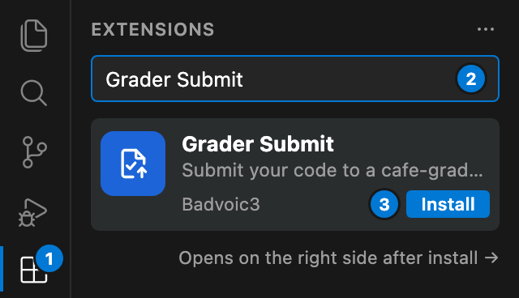

### Where the Panel Lives

- **Secondary Sidebar (Right Side) by Default:** On a fresh install in VS Code 1.106+, the **Grader** panel opens in the **Secondary Sidebar** on the right side of the window so your file Explorer stays visible on the left.
- **Opens on Startup (`cedtGrader.panel.openOnStartup`):** By default (`true`), the panel opens automatically when you start a VS Code window while keeping keyboard focus in your editor. Turn `cedtGrader.panel.openOnStartup` off if you prefer to open it manually (`Grader: Show Panel`).
- **Moving the Panel:** Drag the **Grader** title or icon to the left Activity Bar (Primary Sidebar) or bottom Panel. VS Code remembers your placement across restarts and updates.
- **Cursor Note:** In Cursor (where the right sidebar is reserved for Cursor's AI pane), the **Grader** panel opens in the Primary Sidebar on the left.

  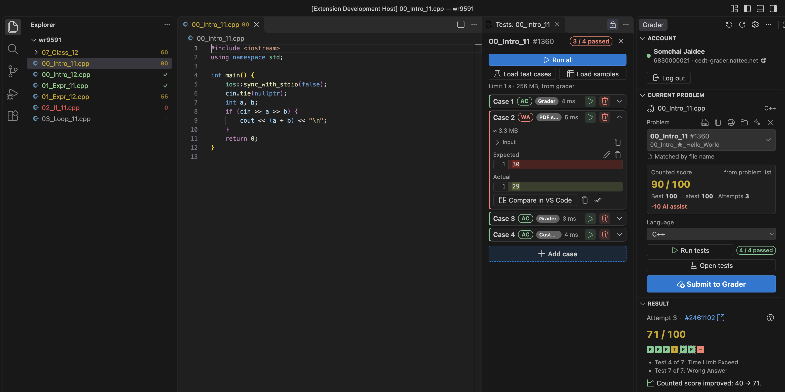

---

## 2. Account, Server Selection & Website Link

  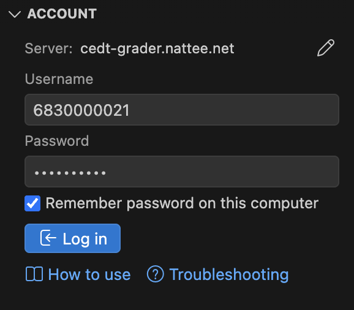

- **Server Line (`Server: <host>`):** At the top of the logged-out **Account** section, `Server: cedt-grader.nattee.net` shows which `cafe-grader-web` server will receive your login.
- **Changing the Server:** Click the **✎** (edit) button next to `Server:` to enter another `cafe-grader-web` URL (or set `cedtGrader.baseUrl` in your **User Settings**). As you type or press <kbd>Enter</kbd>, the extension checks whether the server is reachable and compatible (`Works with Grader Submit`) before your password is ever sent. Click **Use the default server** to switch back to `https://cedt-grader.nattee.net`.
- **Logging In:** Enter your username and password and press **Log in**. With **Remember password on this computer** ticked, your password and session token are stored in your OS keychain (`SecretStorage`) so expired 12-hour tokens renew automatically.
- **Help Row (`How to use` · `Troubleshooting`):** While logged out, **How to use** (opens this User Guide on GitHub) and **Troubleshooting** sit at the bottom of **Account** and in the panel's **⋯** menu.
- **Website Icon (`🌐`):** Once logged in, click the globe icon right next to `<username> · <host>` in **Account** to open the grader website in your browser. **Log out** clears your session and deletes any saved password from the keychain.

---

## 3. Panel Sections at a Glance

  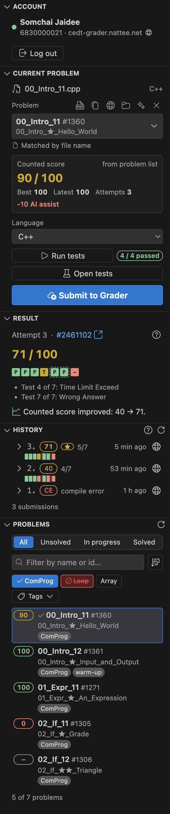

| Section | Purpose |
|---|---|
| **Account** | Server selector (when logged out), login/logout controls, and the **🌐** button to open the grader website. |
| **Current problem** | Active file (or linked folder), matched problem, counted score card, language selector, **Load test cases** / **Load samples**, **Run tests** / **Open tests**, and **Submit to Grader**. |
| **Result** | Live grading status and the latest submission's score, per-test verdict tiles, group boxes, and compiler messages. |
| **History** | Every submission for the current problem (including website submissions), expandable with per-test runtime/memory and 1-click source diffing. |
| **Trophies** | Your first full scores, daily coding streak, completed topics, and per-topic progress bars (shown when `cedtGrader.fun.enabled` is on). |
| **Problems** | Searchable, filterable list of all problems on the grader with counted scores, topic pills, and tag filters. |

You can reorder or hide any section with `cedtGrader.panel.sections` (**Account** always appears while logged out) and tighten spacing with `cedtGrader.panel.compact`.

---

## 4. Linking Files & Folders to Problems

  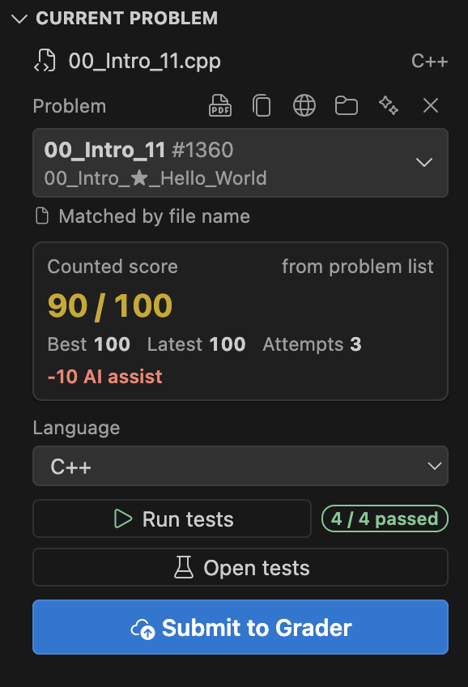

### How Matching Works

1. **Chosen by you (`saved`):** Picking a problem from the **Current problem** dropdown saves a link in VS Code's hidden storage (`globalStorageUri/links/links.json`). Your workspace stays completely clean — no `.cedt-grader.json` files are created.
2. **Matched by file name (`filename`):** A file named like a problem (`00_Intro_11.cpp` or matching `cedtGrader.fileNamePattern`, e.g. `{id}_{name}.{ext}`) matches automatically. Case, spaces, `-`, `_`, and `.` are ignored.
3. **Matched by folder name (`folder`):** If the file name does not match a problem, the immediate folder name is checked with the same rules.
4. **Suggested (`suggested`):** If a file or folder name is close to a problem name, it appears as `Suggested from the file name · Use this`. You can view its score, history, and statement right away; clicking **Use this** (or confirming on first submit) saves the link.

### Working at the Workspace Root or Outside a Workspace

- **Workspace-root packages (`File → Open Folder… → package_vector/`):** Opening a problem folder directly as your workspace root matches by the workspace folder's name and supports Folder Mode at the root.
- **Single files outside a workspace (`code ~/Downloads/solution.cpp`):** Files opened without a workspace folder (or outside the open workspace) match by file name or immediate parent directory name, and their links and test cases persist in global storage. Clicking a problem row whose linked file is outside the current workspace opens that file directly.

### Header Icons & Multiple Linked Files

- **Header icons next to the problem name:**
  - **Open statement** (PDF icon) · **Copy problem name** · **Open on the grader website**
  - **Download attachment** (cloud icon, shown when the problem has an attachment)
  - **Link the whole folder** / **Link only this file** (folder icon)
  - **Auto-detect** (sparkle icon, when unlinked) · **✕** (**Unlink this file** / **Don't match this file** / **Unlink this folder**)
- **Right-click menu:** Right-clicking the problem card offers all header actions plus **Rename file to match the problem** (uses `cedtGrader.fileNamePattern`, lets you edit the name first, never overwrites an existing file, and supports Undo).
- **Multiple files for one problem:** When two or more files in your workspace match the same problem, a notice lets you **Show the files** (**Open** / **Unlink** / **Unlink the other files**) or **Dismiss** until the files change. If you submit while another linked file was edited more recently, an inline prompt asks which one you meant.

  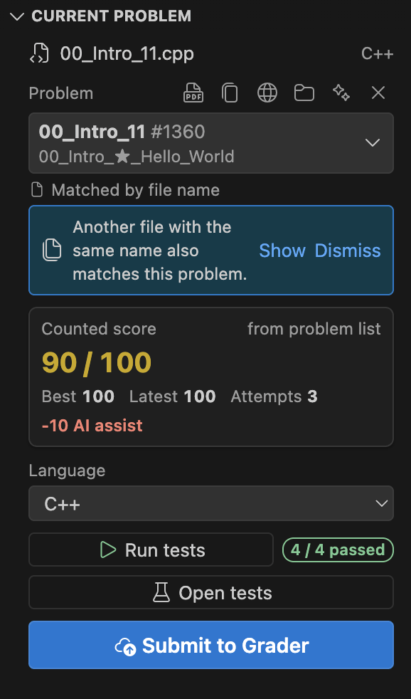

---

## 5. Folder Mode, Packages & Attachments

Many data-structure and class problems ship as a package with a driver `main.cpp` and a header or implementation file you edit (such as `student.h`).

  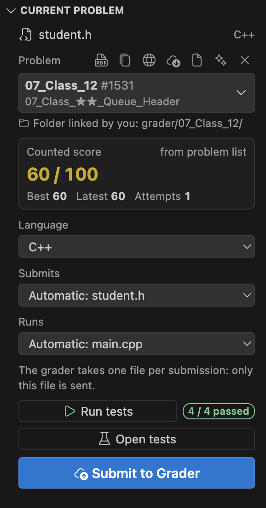

### Downloading Attachments

Click **Download attachment** on the current problem or any problem row (or run **Grader: Download Problem Attachment**):

- **Single file (e.g. template `.cpp` or `.dig`):** Saved beside your active file (or into a folder you pick if no workspace is open), opened in the editor, and offered **Rename file to match the problem**. Existing files are never overwritten (`_2`, `_3`, …).
- **Zip package:** Inspected before extraction (refuses path traversal, > 500 entries, or > 50 MB; skips `__MACOSX`, hidden `.git` / `.vscode` folders, and pre-compiled binaries). Then choose:
  - **Name it after the problem (`<problem>/`) and link it** — extracts into a new folder and enables Folder Mode automatically.
  - **Keep the original name (`<name>/`), don't link** — extracts into a new folder without linking.

### Automatic `Submits` and `Runs` Detection

In Folder Mode (whether linked manually, extracted from a zip, matched by folder name, or opened as the workspace root with both `main.cpp` and `student.h` present), Grader Submit detects two roles automatically:

- **Submits (`student.h`):** The single file sent when you press **Submit to Grader** (since `cafe-grader` accepts one file per submission and compiles it with the server's driver).
- **Runs (`main.cpp`):** The entry-point file containing `main()` that **Run tests** compiles together with the folder's other source files.

Hover either dropdown (`Automatic: <file>`) to see why that file was selected, or pick a different file from the dropdown to override it.

---

## 6. Built-in Test Runner & Test Split View

Grader Submit includes a zero-configuration local test runner for **C++** (`gnu++17 -O2 -DEVAL`), **C** (`gnu11 -O2 -DEVAL`), **Python**, **Java**, **Rust**, **Go**, **Haskell**, **Ruby**, **Pascal**, and **PHP**.

  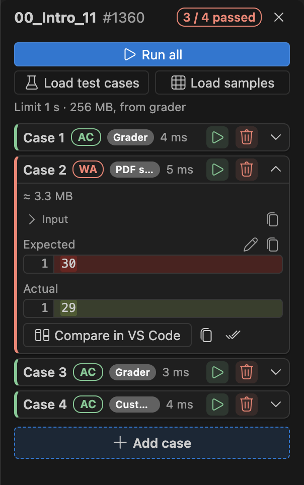

### Loading Cases

At the top of the **Tests** split view (or from the Command Palette), two buttons sit side by side:

- **Load test cases:** Downloads official test cases from the grader API (for problems that publish them). Cases are deduplicated automatically, and trailing `KEY: …` lines printed only by the grader's secret driver are stripped in Folder Mode so local runs match.
- **Load samples:** Reads the example input/output table directly from the problem statement PDF — works on any problem with a ruled PDF example table, even when the grader hides official test cases.

### Running & Inspecting Cases

- **Run tests (`Grader: Run Tests`):** Saves dirty files (when `cedtGrader.saveBeforeSubmit` is on), compiles your program into `<os.tmpdir()>/cedt-grader-bin/` (skipping recompilation when source and headers haven't changed, and falling back automatically if `/tmp` is mounted `noexec`), and runs each case sequentially with process-group cleanup and a 64 KB display cap.
- **Open tests (`Grader: Open Tests`):** Opens the **Tests** split view in a locked editor group beside your code:
  - View **Passed (`AC`)**, **Wrong Answer (`WA`)**, **Time Limit (`TLE`)**, **Runtime Error (`RE`)**, or **Compile Error** with runtime (`ms`) and estimated peak memory (`MB` on macOS and Linux).
  - Inspect line-numbered **Input**, **Expected**, **Actual**, and collapsible **Stderr** (stderr never fails a case if exit code is `0` and stdout matches).
  - Highlight character/token differences inline, click **Compare in VS Code** to open a full side-by-side diff editor, or click **Use as expected** to adopt the current output.
  - Add custom cases (**+ Add case**), edit inputs/outputs inline (editing a grader or PDF sample case turns its badge into `Custom`), reorder cases by drag or <kbd>Alt</kbd>+<kbd>↑</kbd>/<kbd>↓</kbd>, and re-run individual cases.
  - If only `PDF Sample` cases fail twice in a row, a tip reminds you to check the statement PDF in case the table layout was misread.

---

## 7. Problem Statements

Click the PDF icon (**Open statement** or `Grader: Open Problem Statement`) to open the statement in a locked split tab beside your code:

- **Controls:** Zoom with trackpad pinch or <kbd>Cmd</kbd>/<kbd>Ctrl</kbd>+<kbd>+</kbd>/<kbd>-</kbd>, fit width with <kbd>Cmd</kbd>/<kbd>Ctrl</kbd>+<kbd>0</kbd>, step through pages, and search text with <kbd>Cmd</kbd>/<kbd>Ctrl</kbd>+<kbd>F</kbd>.
- **Follows your active file (`cedtGrader.statementFollowsFile`):** Switching to another solution file updates the open statement tab in place without stealing focus, and closes it when you switch to a source file with no problem.
- **Offline cache:** Statements are cached in `globalStorageUri` (up to `cedtGrader.cacheMaxMB`) and reopen across restarts without network requests.

---

## 8. Submitting, Results & History

### Submitting

- Press **Submit to Grader** in **Current problem**, click the status bar item (`$(cloud-upload) Submit to Grader`), or run **Grader: Submit Current File**.
- With `cedtGrader.confirmBeforeSubmit` on (`true`), an auto-matched file asks once right above the Submit button; confirming saves the match as **Chosen by you** so subsequent submits go straight through.
- With `cedtGrader.saveBeforeSubmit` on (`true`), the file is saved before upload so formatters run first.

### Result Section

  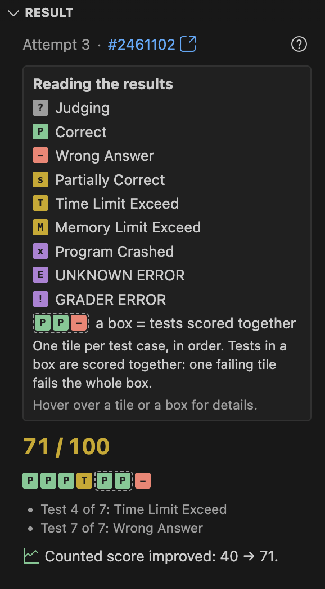

- Shows live polling (`Submitting…` → `Grading…`) and opens automatically when finished (`cedtGrader.revealResultAfterSubmit`).
- Displays one coloured tile per test case (`P` correct, `-` wrong answer, `T` time limit, `X` crash/memory limit, `S` partial) and dashed boxes around grouped test cases (where the lowest tile determines the group's score). Click **?** to toggle the legend.

### History Section

  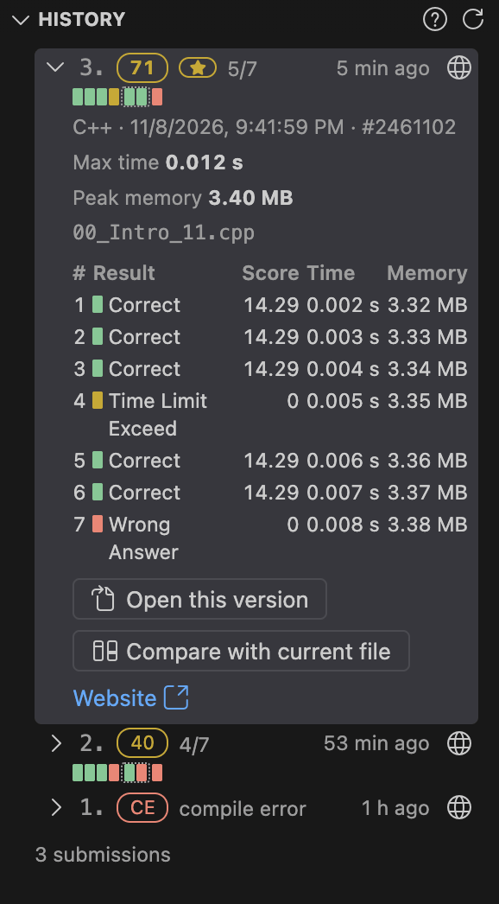

- Lists every submission for the problem, with a `★` badge on the submission that holds your counted score.
- Click any submission to load per-test scores, runtime, peak memory, compiler output, **Open this version** (read-only editor), and **Compare with current file** (side-by-side diff against your active file).

---

## 9. Problems List, Topic Pills & Tag Filters

  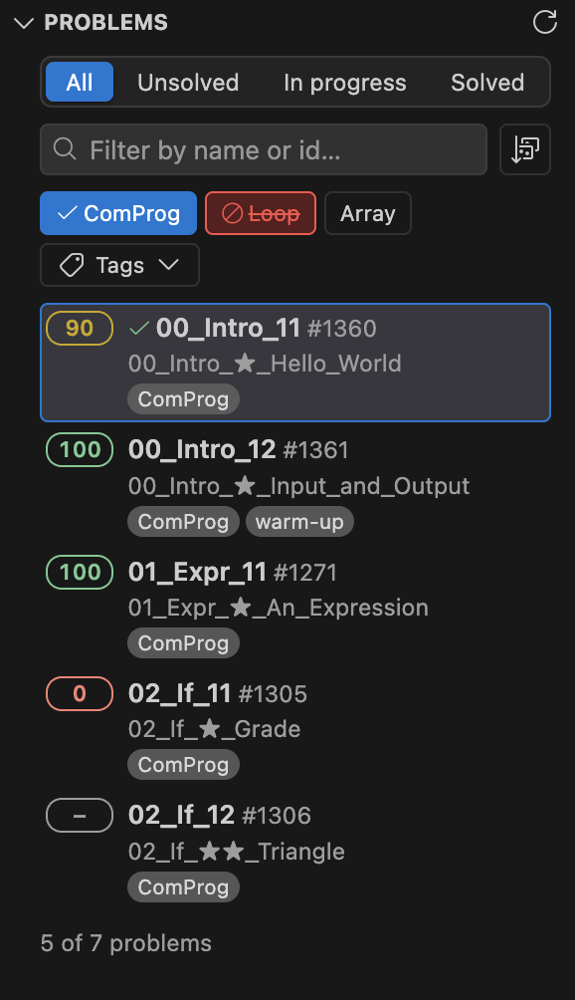

- **Status Tabs:** Filter by **All**, **Unsolved** (untried or counted score < 100), **In progress**, or **Solved** (best ≥ 100).
- **Topic Pills (3 states):** Click a topic pill once to **show only** problems in that topic (filled with `✓`), click a second time to **hide** problems in that topic (red, struck through), and click a third time to turn it off. Set `cedtGrader.panel.topicClickOrder` to `hideFirst` if you prefer hiding on the first click.
- **Tags Dropdown (`Tags`):** Filter by non-topic tags (e.g. `BFS`, `DP`, `Greedy`) combined with **Any (OR)** or **All (AND)**.
- **Search & Sort:** Search by problem name, full title, or ID, and sort by **Default order**, **Default order (reversed)**, **Name A–Z**, **Name Z–A**, **Latest submission**, **Score (low → high)**, **Score (high → low)**, or **Recently opened**.
- **Row Actions & Keyboard Navigation:** Click a row to open its linked file (or choose whether to link the open file, create a new file, find a matching file, or open the statement). Hover or focus a row for quick icons, right-click for the context menu, or navigate with <kbd>↑</kbd> / <kbd>↓</kbd> / <kbd>Home</kbd> / <kbd>End</kbd> and <kbd>Tab</kbd>.

---

## 10. Explorer Badges

Grader Submit decorates files and Folder Mode folders in the VS Code Explorer and editor tabs without scanning the network:

  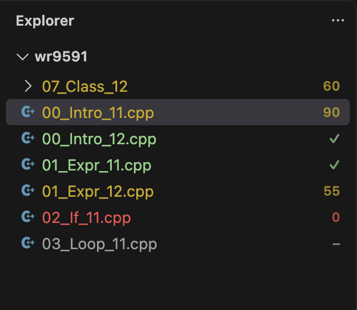

- **Badge Mode (`cedtGrader.explorer.badge`):**
  - `score` (default): shows `✓` for a full score (`100`), `0`–`99` for partial/zero scores, and `–` for untried problems.
  - `tag`: shows the first two letters of the problem's first topic tag (e.g. `GR`, `DP`), with all tags and the counted score in the hover tooltip.
  - `off`: disables Explorer badges.
- **Badge & Filename Colours (`cedtGrader.explorer.colors`, default `true`):** Tints badges and file names green (`100`), amber (`1`–`99`), red (submitted with `0`), or grey (untried) in `score` mode, or deterministically by topic tag in `tag` mode (unconfirmed suggestions stay neutral). Colours can be customized in `workbench.colorCustomizations` under `cedtGrader.explorer.*`.

---

## 11. Celebrations, Trophies & Break Scenes

Controlled by `cedtGrader.fun.enabled` (default `true`; turning it `false` hides Trophies and disables automatic triggers while keeping the manual Command Palette commands available):

  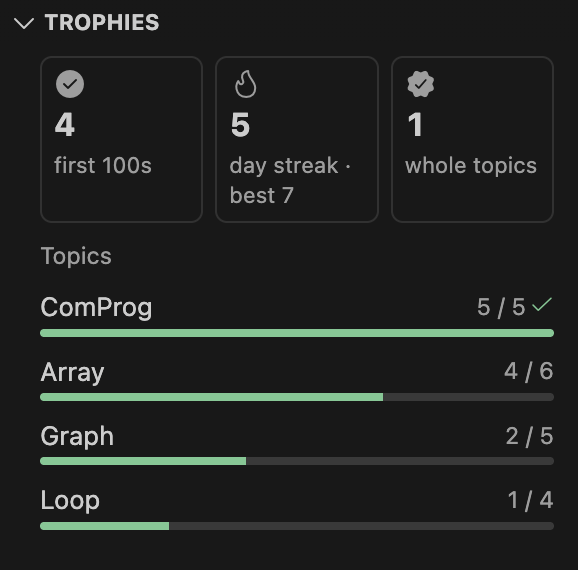

- **First-Full-Score Celebration (`cedtGrader.fun.celebrate`):** The first time a problem reaches a counted score of `100` (or passes every test on raw-sum / hint-capped problems), the Result card plays a ring fill, confetti burst, ribbon, and trophy toast. Replay anytime with **Grader: Play Celebration**.
- **Trophies Section (`Grader: Show Trophies`):** Displays your total **First 100s**, current and best daily **Streak**, **Whole topics** completed, and progress bars for every course topic.
- **Break Reminder (`cedtGrader.fun.breakReminder`, `cedtGrader.fun.breakMinutes`):** After `90` minutes of active coding (edits, test runs, submits; a 10-minute idle gap resets the timer), a quiet `☕ Break?` hint appears in the status bar. Between 20 and 60 minutes later — only at a natural stopping point (after a full score, all local tests passing, or switching problems; never after a failure or during an exam) and at most twice a day — an inline prompt offers **Start a 5-min break**, **Snooze 30 min**, or **Not today**.
- **Five Interactive Break Scenes (`cedtGrader.fun.breakScene`):** Transforms the visible lines of your open code (with real syntax highlighting) into an interactive 5-minute break tab with smooth spring entry/exit:
  1. **Falling Code (`sand`):** Code characters fall like sand; push, scoop, or pour them with the mouse (`Grader: Take a Break: Falling Code`).
  2. **3D Donut (`donut3d`):** Code spins into a 3D torus (`Grader: Take a Break: 3D Donut`).
  3. **2D Donut (`donut2d`):** Code spins into a flat text donut (`Grader: Take a Break: 2D Donut`).
  4. **Breathing (`breathe`):** Code forms a calm ring that expands and contracts with a 4-second breath cycle (`Grader: Take a Break: Breathing`).
  5. **Swarm (`swarm`):** Code swirls through a 2D grid-fluid simulation following your pointer (`Grader: Take a Break: Swarm`).

---

## 12. Look & Feel, Language & Storage

- **Panel Look (`cedtGrader.panel.look`):** `subtle` (default) adds sticky section headers, raised cards, smooth section/menu animations (respecting `prefers-reduced-motion`), and frosted menus/tooltips when VS Code's own menus use frost. Switch to `plain` for flat, animation-free styling.
- **Display Language (`cedtGrader.displayLanguage`):** Choose `en` (English), `th` (Thai), or `auto` (Follow VS Code). Switching applies immediately to the panel, Test view, statement viewer, status bar, and messages. Command names and setting descriptions follow VS Code's own display language.
- **Clear Cached Data (`Grader: Clear Cached Data…`):** Accessible from the Command Palette or the panel's **⋯** menu. Shows disk usage and lets you selectively clear:
  - **Downloaded files** (cached PDFs, grader test cases, submission details — ticked by default)
  - **Problem list, history and remembered matches** (ticked by default)
  - **Custom test cases** (unticked by default)
  - **File-to-problem links** (unticked by default)
  - **Saved login** (unticked by default)
  - **Backup files from test-case imports** (`.prob.bak`, shown only if present)

---

## 13. Upgrading from v1.0.0 & Cleaning Up Old Files

In `v1.0.0`, links were stored in `.cedt-grader.json` and test cases were exported to `.cph/*.prob` or `<problem>/tests/*.in|out`. Starting in `v1.1.0`:

1. **Silent automatic migration:** When you open a workspace folder containing `.cedt-grader.json` or `.cph/*.prob` files for your grader, Grader Submit automatically copies your file/folder links and deduplicated test cases into hidden storage (`globalStorageUri`).
2. **Recoverable cleanup offer:** An inline prompt in the panel offers to move the old `.cedt-grader.json`, `.cph/*.prob` (only those belonging to this grader, leaving other judges' CPH files untouched), and compiled `<stem>.bin` files to your OS Trash.
3. **Run anytime:** You can re-run this cleanup whenever you want via **Grader: Clean Up Old Files** (`cedtGrader.cleanUpOldFiles`).

---

## Troubleshooting

  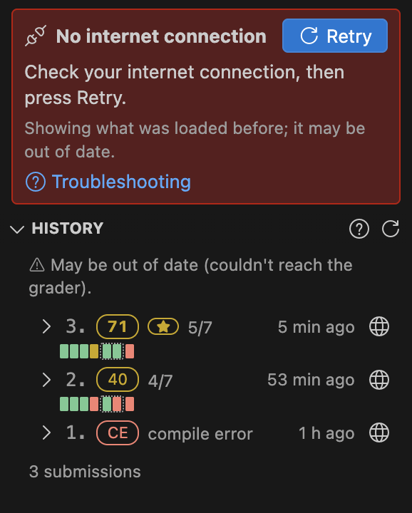

### Login & Server Issues

- **"Wrong username or password."** — Check your credentials on the grader website. Any saved password for that account is cleared automatically so you can type a fresh one.
- **"Too many failed login attempts."** — `cafe-grader` temporarily blocks logins after repeated failures (counting website and extension attempts together). Wait a few minutes before clicking **Retry**; the extension never auto-retries a failed login.
- **"The grader refused the login."** — Your account may be disabled or restricted to campus/exam networks. Contact your instructor.
- **"This address isn't a supported grader"** — Shown by the `Server:` check in **Account** when the URL does not respond like a `cafe-grader-web` server. Verify the URL or click **Use the default server**.
- **"The grader … sent the request on to another address …, so it was stopped."** — Cross-origin redirects are refused to protect your credentials. If the course moved to a new domain, update `cedtGrader.baseUrl` in User Settings.

### Problem Matching & Folder Mode

- **The wrong problem is matched to my file.** — Click the problem selector under **Current problem** and pick the intended problem (saved as **Chosen by you**), or click **✕** to stop auto-matching that file.
- **How do I link a multi-file package (`main.cpp` + `student.h`)?** — Click the folder icon (**Link the whole folder**) on **Current problem**, or open the unzipped package folder directly as your workspace root when both `main.cpp` and `student.h` are present.
- **"2 files are linked to this problem"** — Click **Show the files** in the notice to open or unlink the extra file, or click **Dismiss** to hide the notice until the files change.

### Local Test Runner & Samples

- **`Run tests` says the compiler was not found.** — Make sure your language's compiler/interpreter (`g++`, `gcc`, `python3`, `javac`/`java`, `rustc`, `go`, `ghc`, `ruby`, `fpc`, `php`) is installed and on `PATH`, or configure its full path in `cedtGrader.runner.compilerPaths`.
- **My program passes locally but fails on the grader (or vice versa).** — Local runs compile `C++` with `-std=gnu++17 -O2 -DEVAL` and compare stdout with trailing spaces ignored. Check for uninitialized variables, out-of-bounds memory access, or platform-specific behavior. Memory figures on macOS/Linux are estimates (Windows shows `—`).
- **`Load samples` says no example table was found, or a sample case looks wrong.** — PDF extraction reads selectable text from ruled input/output tables. Scanned image PDFs cannot be read, and multi-column or borderless PDF layouts can occasionally merge lines. Compare against the statement PDF and edit the case in the **Tests** view.

### Crashes & Bug Reports

- If an unexpected error occurs, an inline **Something went wrong in Grader Submit** card displays the exact redacted report (all tokens, passwords, and personal paths removed). Click **Report on GitHub** to open a prefilled issue, or see [**`SUPPORT.md`**](SUPPORT.md).
