# Grader Submit — คู่มือการใช้งาน

[English](USERGUIDE.md) · **ภาษาไทย**

[**← กลับไปหน้า README**](README.th.md) · [**คู่มือสำหรับนักพัฒนา (`DEVGUIDE.md`)**](DEVGUIDE.md) · [**การขอความช่วยเหลือ (`SUPPORT.md`)**](SUPPORT.md) · [**ประวัติการเปลี่ยนแปลง (`CHANGELOG.md`)**](CHANGELOG.md)

Grader Submit ช่วยให้คุณทำโจทย์บนเซิร์ฟเวอร์ [cafe-grader-web](https://github.com/nattee/cafe-grader-web) ได้ครบทุกขั้นตอนจากใน VS Code ตั้งแต่การจับคู่ไฟล์กับโจทย์ การอ่านโจทย์ PDF ข้างโค้ด ตัวรันทดสอบในตัว การจัดการโจทย์แบบหลายไฟล์ (Folder Mode) การดูผลตรวจสด การเทียบโค้ดกับประวัติการส่ง ป้ายคะแนนใน Explorer ไปจนถึงเอฟเฟกต์ฉลองคะแนนเต็มและหน้าพักสายตา

> **หมายเหตุ:** ส่วนขยายนี้เป็นเครื่องมือช่วยจัดการขั้นตอนการเขียนและส่งโค้ดอย่างไม่เป็นทางการ (Unofficial Developer Workflow Extension) ไม่ได้พัฒนาโดยผู้ดูแลระบบ Grader

---

## สารบัญ

1. [การติดตั้งและตำแหน่งของแผง Grader](#1-การติดตั้งและตำแหน่งของแผง-grader)
2. [บัญชี การเลือกเซิร์ฟเวอร์ และปุ่มเปิดเว็บไซต์](#2-บัญชี-การเลือกเซิร์ฟเวอร์-และปุ่มเปิดเว็บไซต์)
3. [ภาพรวมส่วนต่าง ๆ ของแผง Grader](#3-ภาพรวมส่วนต่าง-ๆ-ของแผง-grader)
4. [การเชื่อมไฟล์และโฟลเดอร์เข้ากับโจทย์](#4-การเชื่อมไฟล์และโฟลเดอร์เข้ากับโจทย์)
5. [โหมดโฟลเดอร์ แพ็กเกจโจทย์ และไฟล์แนบ](#5-โหมดโฟลเดอร์-แพ็กเกจโจทย์-และไฟล์แนบ)
6. [ตัวรันทดสอบในตัวและหน้าทดสอบ (Tests View)](#6-ตัวรันทดสอบในตัวและหน้าทดสอบ-tests-view)
7. [การอ่านโจทย์ (Problem Statements)](#7-การอ่านโจทย์-problem-statements)
8. [การส่งงาน ผลลัพธ์ และประวัติการส่ง](#8-การส่งงาน-ผลลัพธ์-และประวัติการส่ง)
9. [รายการโจทย์ ปุ่มหัวข้อ และตัวกรองแท็ก](#9-รายการโจทย์-ปุ่มหัวข้อ-และตัวกรองแท็ก)
10. [ป้ายกำกับใน Explorer (Explorer Badges)](#10-ป้ายกำกับใน-explorer-explorer-badges)
11. [เอฟเฟกต์ฉลอง ถ้วยรางวัล และหน้าพักสายตา](#11-เอฟเฟกต์ฉลอง-ถ้วยรางวัล-และหน้าพักสายตา)
12. [รูปลักษณ์ ภาษาที่แสดง และการจัดการข้อมูลแคช](#12-รูปลักษณ์-ภาษาที่แสดง-และการจัดการข้อมูลแคช)
13. [การอัปเกรดจาก v1.0.0 และการล้างไฟล์ระบบเก่า](#13-การอัปเกรดจาก-v100-และการล้างไฟล์ระบบเก่า)
14. [การแก้ปัญหาเบื้องต้น](#การแก้ปัญหาเบื้องต้น)

---

## 1. การติดตั้งและตำแหน่งของแผง Grader

ต้องใช้ **VS Code 1.106 ขึ้นไป**

- **ติดตั้งผ่าน VS Code Marketplace:** เปิดหน้า **Extensions** (<kbd>Cmd</kbd>+<kbd>Shift</kbd>+<kbd>X</kbd> บน macOS / <kbd>Ctrl</kbd>+<kbd>Shift</kbd>+<kbd>X</kbd> บน Windows และ Linux) ค้นหา **Grader Submit** (`Badvoic3.cedt-grader-submit`) แล้วคลิก **Install**
- **ติดตั้งจากไฟล์ `.vsix`:** ดาวน์โหลดไฟล์ `cedt-grader-submit-<version>.vsix` จากหน้า [GitHub Releases](https://github.com/Badvoic3/cedt-grader-vscode/releases/latest) คลิกปุ่ม **⋯ → Install from VSIX…** ในหน้า Extensions แล้วเลือกไฟล์ที่ดาวน์โหลดมา

  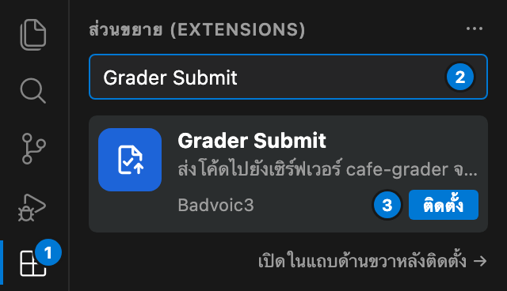

### ตำแหน่งของแผง Grader

- **เปิดทางด้านขวา (Secondary Sidebar) เป็นค่าเริ่มต้น:** เมื่อติดตั้งครั้งแรกบน VS Code 1.106 ขึ้นไป แผง **Grader** จะเปิดอยู่ในแถบด้านข้างฝั่งขวา เพื่อให้คุณเปิดดูรายชื่อไฟล์ใน Explorer ทางด้านซ้ายควบคู่กันได้ทันที
- **เปิดอัตโนมัติเมื่อเริ่มโปรแกรม (`cedtGrader.panel.openOnStartup`):** ค่าเริ่มต้น (`true`) จะเปิดแผง Grader เองเมื่อเปิดหน้าต่าง VS Code โดยที่เคอร์เซอร์ยังอยู่ในเอดิเตอร์ตามเดิม หากต้องการเปิดเองเฉพาะตอนใช้ สามารถปิดการตั้งค่านี้แล้วเรียกคำสั่ง `Grader: แสดงแผง` (`Grader: Show Panel`) ได้
- **การย้ายตำแหน่งแผง:** คุณสามารถลากหัวข้อหรือไอคอน **Grader** ไปวางไว้ที่แถบกิจกรรมด้านซ้าย (Primary Sidebar) หรือแผงด้านล่างได้ตามต้องการ โดย VS Code จะจำตำแหน่งที่คุณเลือกไว้เสมอ
- **สำหรับผู้ใช้ Cursor:** เนื่องจากแถบด้านขวาของ Cursor ถูกจองไว้สำหรับหน้าต่าง AI แผง **Grader** จึงจะเปิดขึ้นทางด้านซ้ายแทน

  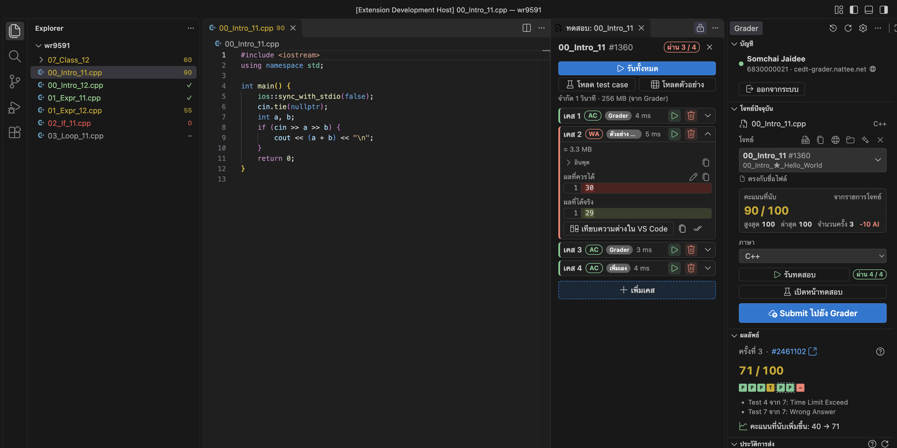

---

## 2. บัญชี การเลือกเซิร์ฟเวอร์ และปุ่มเปิดเว็บไซต์

  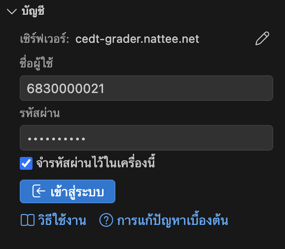

- **บรรทัดเซิร์ฟเวอร์ (`เซิร์ฟเวอร์: <host>`):** ด้านบนสุดของส่วน **บัญชี** ขณะยังไม่ได้เข้าสู่ระบบ จะแสดง `เซิร์ฟเวอร์: cedt-grader.nattee.net` เพื่อบอกให้ชัดเจนว่าจะส่งข้อมูลเข้าสู่ระบบไปที่ใด
- **การเปลี่ยนเซิร์ฟเวอร์:** คลิกปุ่ม **✎** ท้ายบรรทัด `เซิร์ฟเวอร์:` เพื่อกรอก URL ของเซิร์ฟเวอร์ `cafe-grader-web` อื่น (หรือตั้งค่าที่ `cedtGrader.baseUrl` ใน **User Settings**) ขณะที่คุณพิมพ์หรือกด <kbd>Enter</kbd> ส่วนขยายจะตรวจสอบให้ก่อนว่าเซิร์ฟเวอร์นั้นติดต่อได้และรองรับการใช้งาน (`เซิร์ฟเวอร์นี้พร้อมใช้งาน`) ก่อนที่จะส่งรหัสผ่านของคุณออกไป หากต้องการกลับมาใช้ค่าเดิมให้คลิก **ใช้เซิร์ฟเวอร์เริ่มต้น**
- **การเข้าสู่ระบบ:** กรอกชื่อผู้ใช้และรหัสผ่านแล้วกด **เข้าสู่ระบบ** หากติ๊กเลือก **จำรหัสผ่านไว้ในเครื่องนี้** ระบบจะเก็บรหัสผ่านและโทเค็นไว้ใน Keychain ของระบบปฏิบัติการ (`SecretStorage`) และต่ออายุเซสชันให้อัตโนมัติเมื่อโทเค็นหมดอายุ
- **ลิงก์ช่วยเหลือ (`วิธีใช้งาน` · `การแก้ปัญหาเบื้องต้น`):** ขณะยังไม่ได้เข้าสู่ระบบ ด้านล่างของส่วน **บัญชี** และในเมนู **⋯** มุมขวาบนของแผงจะมีลิงก์ **วิธีใช้งาน** (เปิดคู่มือนี้บน GitHub) และ **การแก้ปัญหาเบื้องต้น** ให้กดดูได้ทันที
- **ปุ่มเปิดเว็บไซต์ (`🌐`):** เมื่อเข้าสู่ระบบแล้ว คลิกไอคอนลูกโลกข้างชื่อบัญชี `<username> · <host>` ในส่วน **บัญชี** เพื่อเปิดเว็บไซต์ Grader ในเบราว์เซอร์ ส่วนปุ่ม **ออกจากระบบ** จะล้างเซสชันและลบรหัสผ่านที่จำไว้ออกจาก Keychain

---

## 3. ภาพรวมส่วนต่าง ๆ ของแผง Grader

  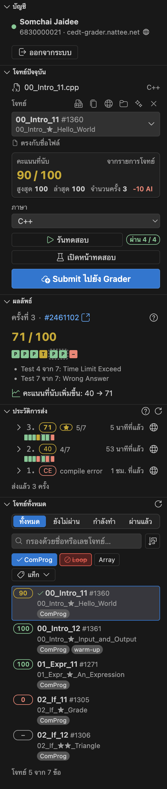

| ส่วน | หน้าที่หลัก |
|---|---|
| **บัญชี (Account)** | เลือกเซิร์ฟเวอร์ (ก่อนเข้าสู่ระบบ) เข้าสู่ระบบ/ออกจากระบบ และปุ่ม **🌐** สำหรับเปิดเว็บไซต์ Grader |
| **โจทย์ปัจจุบัน (Current problem)** | แสดงไฟล์ที่เปิดอยู่ (หรือโฟลเดอร์ที่เชื่อมไว้) โจทย์ที่จับคู่ คะแนนที่นับ ภาษาที่ใช้ ปุ่ม **โหลด test case** / **โหลดตัวอย่าง** ปุ่ม **รันทดสอบ** / **เปิดหน้าทดสอบ** และปุ่ม **Submit ไปยัง Grader** |
| **ผลลัพธ์ (Result)** | แสดงสถานะการตรวจสด คะแนนของการส่งครั้งล่าสุด ช่องผลตรวจรายเคส กรอบกลุ่มเคส และข้อความจากคอมไพเลอร์ |
| **ประวัติการส่ง (History)** | แสดงการส่งทุกครั้งของโจทย์ปัจจุบัน (รวมถึงที่ส่งผ่านหน้าเว็บ) คลิกเพื่อดูเวลา/หน่วยความจำรายเคส และกดเปิดดูโค้ดหรือเทียบความต่างกับไฟล์ปัจจุบันได้ทันที |
| **ถ้วยรางวัล (Trophies)** | สรุปจำนวนข้อที่ได้คะแนนเต็มครั้งแรก จำนวนวันที่ทำโจทย์ต่อเนื่อง หมวดที่ทำครบทุกข้อ และแถบความคืบหน้าแยกตามหมวด (แสดงเมื่อเปิด `cedtGrader.fun.enabled`) |
| **โจทย์ทั้งหมด (Problems)** | รายการโจทย์ทั้งหมดบน Grader พร้อมระบบค้นหา กรองตามสถานะ ปุ่มหัวข้อ 3 สถานะ และตัวกรองแท็ก |

คุณสามารถจัดลำดับหรือซ่อนส่วนที่ไม่ต้องการได้ในการตั้งค่า `cedtGrader.panel.sections` (ส่วน **บัญชี** จะแสดงเสมอเมื่อยังไม่ได้เข้าสู่ระบบ) และปรับให้แสดงผลแบบกะทัดรัดได้ด้วย `cedtGrader.panel.compact`

---

## 4. การเชื่อมไฟล์และโฟลเดอร์เข้ากับโจทย์

  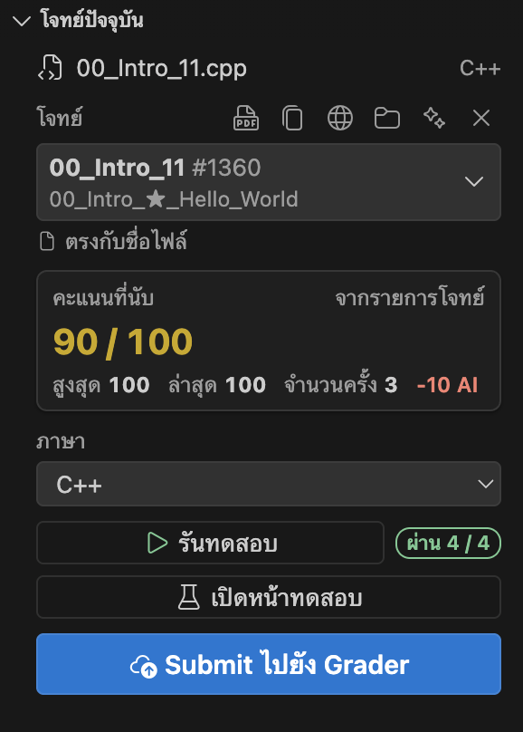

### ลำดับการจับคู่ไฟล์กับโจทย์

1. **คุณเลือกเอง (`saved`):** เมื่อคลิกเลือกโจทย์จากช่องเลือกในส่วน **โจทย์ปัจจุบัน** ระบบจะบันทึกการเชื่อมไว้ในพื้นที่ซ่อนของ VS Code (`globalStorageUri/links/links.json`) โดยไม่สร้างไฟล์ `.cedt-grader.json` ในโฟลเดอร์งานของคุณ
2. **ตรงกับชื่อไฟล์ (`filename`):** ไฟล์ที่ตั้งชื่อตรงกับรหัสหรือชื่อโจทย์ (เช่น `00_Intro_11.cpp` หรือตรงตามรูปแบบใน `cedtGrader.fileNamePattern` เช่น `{id}_{name}.{ext}`) จะถูกจับคู่ให้อัตโนมัติ โดยไม่สนใจตัวพิมพ์ใหญ่-เล็ก ช่องว่าง หรือเครื่องหมาย `-`, `_`, `.`
3. **ตรงกับชื่อโฟลเดอร์ (`folder`):** หากชื่อไฟล์ไม่ตรงกับโจทย์ ระบบจะตรวจชื่อโฟลเดอร์ที่เก็บไฟล์นั้นด้วยกติกาเดียวกัน
4. **แนะนำ (`suggested`):** หากชื่อไฟล์หรือโฟลเดอร์ใกล้เคียงกับชื่อโจทย์ ระบบจะแสดงเป็น `แนะนำจากชื่อไฟล์ · ใช้โจทย์นี้` ซึ่งคุณสามารถเปิดอ่านโจทย์และดูคะแนนได้ทันที และเมื่อคลิก **ใช้โจทย์นี้** (หรือกดยืนยันตอนส่งครั้งแรก) ระบบจะบันทึกเป็นโจทย์ของไฟล์นั้น

### การใช้งานเมื่อเปิดโฟลเดอร์โจทย์เป็น Root หรือเปิดไฟล์เดี่ยวนอก Workspace

- **เปิดโฟลเดอร์โจทย์เป็น Workspace Root (`File → Open Folder… → package_vector/`):** หากเปิดโฟลเดอร์ของโจทย์เป็นโฟลเดอร์หลักของหน้าต่าง VS Code ระบบจะจับคู่จากชื่อโฟลเดอร์นั้นและรองรับโหมดโฟลเดอร์ที่ระดับ root ทันที
- **เปิดไฟล์เดี่ยวนอก Workspace (`code ~/Downloads/solution.cpp`):** ไฟล์ที่เปิดโดยไม่ได้เปิดโฟลเดอร์โปรเจกต์ (หรืออยู่นอกโฟลเดอร์ที่เปิดอยู่) จะจับคู่จากชื่อไฟล์หรือชื่อโฟลเดอร์แม่ และบันทึกการเชื่อมรวมถึง test case ไว้ในพื้นที่ส่วนกลาง เมื่อคลิกแถวโจทย์ในรายการ ระบบจะเปิดไฟล์นั้นขึ้นมาให้ได้โดยตรง

### ไอคอนคำสั่งด่วนและกรณีมีหลายไฟล์ตรงกับโจทย์เดียวกัน

- **ไอคอนด้านขวาของชื่อโจทย์:**
  - **เปิดโจทย์** (ไอคอน PDF) · **คัดลอกชื่อโจทย์** · **เปิดบนเว็บ Grader**
  - **ดาวน์โหลดไฟล์แนบ** (ไอคอนก้อนเมฆ แสดงเฉพาะโจทย์ที่มีไฟล์แนบ)
  - **เชื่อมทั้งโฟลเดอร์** / **เชื่อมเฉพาะไฟล์นี้** (ไอคอนโฟลเดอร์)
  - **ตรวจหาอัตโนมัติ** (ไอคอนประกายดาว เมื่อยังไม่ได้เชื่อม) · **✕** (**ยกเลิกการเชื่อมไฟล์นี้** / **ไม่ต้องจับคู่ไฟล์นี้** / **ยกเลิกการเชื่อมโฟลเดอร์นี้**)
- **เมนูคลิกขวา:** คลิกขวาที่การ์ดโจทย์เพื่อเรียกคำสั่งทั้งหมด รวมถึงคำสั่ง **เปลี่ยนชื่อไฟล์ให้ตรงกับโจทย์** (ใช้รูปแบบจาก `cedtGrader.fileNamePattern` ให้แก้ไขชื่อก่อนได้ ไม่เขียนทับไฟล์เดิม และกด Undo ได้)
- **เมื่อมีหลายไฟล์เชื่อมกับโจทย์ข้อเดียวกัน:** ระบบจะแสดงแถบแจ้งเตือนให้คลิก **แสดง** เพื่อเลือก **เปิด** / **ยกเลิกการเชื่อม** / **ยกเลิกการเชื่อมไฟล์อื่น** หรือกด **ปิด** เพื่อซ่อนข้อความไว้จนกว่าไฟล์จะเปลี่ยน และหากคุณกด Submit ขณะที่มีอีกไฟล์ของโจทย์เดียวกันเพิ่งแก้ไขใหม่กว่า ระบบจะถามยืนยันก่อนส่งเสมอ

  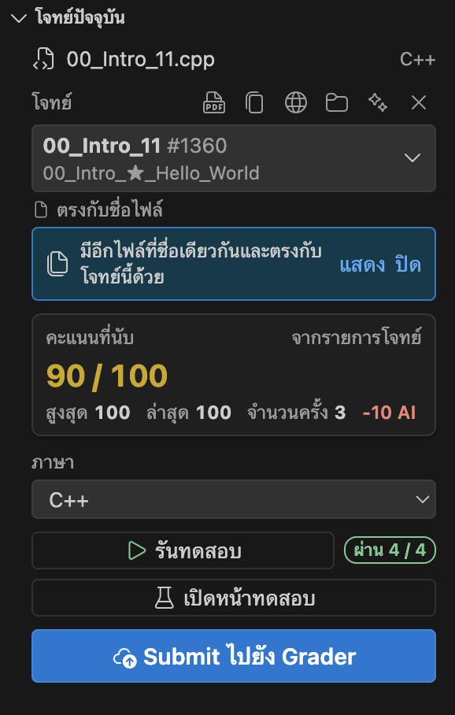

---

## 5. โหมดโฟลเดอร์ แพ็กเกจโจทย์ และไฟล์แนบ

โจทย์โครงสร้างข้อมูลและคลาสหลายข้อจะแจกเป็นแพ็กเกจที่มีไฟล์ทดสอบ `main.cpp` คู่กับไฟล์ที่คุณต้องเขียนเพิ่ม (เช่น `student.h`)

  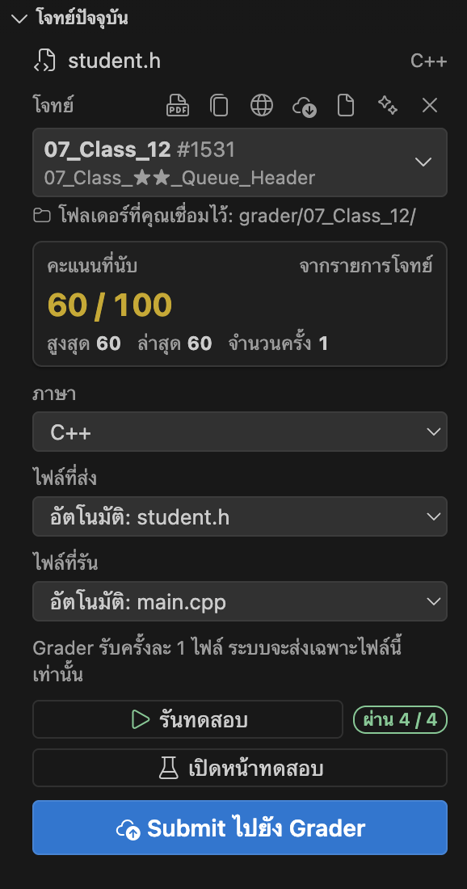

### การดาวน์โหลดไฟล์แนบของโจทย์

คลิกปุ่ม **ดาวน์โหลดไฟล์แนบ** ในส่วนโจทย์ปัจจุบันหรือท้ายแถวโจทย์ (หรือเรียกคำสั่ง **Grader: ดาวน์โหลดไฟล์แนบของโจทย์**):

- **ไฟล์เดี่ยว (เช่น ไฟล์โครงร่าง `.cpp` หรือ `.dig`):** บันทึกไว้ข้างไฟล์ที่เปิดอยู่ (หรือให้เลือกโฟลเดอร์หากไม่ได้เปิด workspace) เปิดขึ้นในเอดิเตอร์ และถามว่าต้องการเปลี่ยนชื่อให้ตรงกับโจทย์หรือไม่ โดยไม่เขียนทับไฟล์ที่มีอยู่แล้ว (`_2`, `_3`, …)
- **ไฟล์แพ็กเกจ `.zip`:** ระบบจะตรวจสอบความปลอดภัยก่อนแตกไฟล์ (ปฏิเสธพาธที่ออกนอกโฟลเดอร์, ไฟล์เกิน 500 รายการ หรือขนาดรวมเกิน 50 MB และข้ามโฟลเดอร์ `__MACOSX`, `.git` / `.vscode` รวมถึงไฟล์ไบนารีที่คอมไพล์มาแล้ว) จากนั้นให้คุณเลือกว่าจะ:
  - **ตั้งชื่อตามโจทย์ (`<problem>/`) และเชื่อมกับโจทย์** — แตกไฟล์ลงในโฟลเดอร์ใหม่และเปิดใช้โหมดโฟลเดอร์ให้อัตโนมัติ
  - **ใช้ชื่อเดิม (`<name>/`) โดยไม่ต้องเชื่อม** — แตกไฟล์ลงในโฟลเดอร์ใหม่โดยไม่เชื่อมกับโจทย์

### การแยก `ไฟล์ที่ส่ง` และ `ไฟล์ที่รัน` อัตโนมัติ

เมื่ออยู่ในโหมดโฟลเดอร์ (ไม่ว่าจะกดเชื่อมทั้งโฟลเดอร์เอง แตกไฟล์จาก zip จับคู่จากชื่อโฟลเดอร์ หรือเปิดโฟลเดอร์ที่มีทั้ง `main.cpp` และ `student.h` เป็น root ของ workspace) ระบบจะแยกหน้าที่ของไฟล์ให้อัตโนมัติเป็น 2 ส่วน:

- **ไฟล์ที่ส่ง (`student.h`):** ไฟล์เดียวที่จะถูกส่งขึ้นไปตรวจเมื่อกด **Submit ไปยัง Grader** (เนื่องจาก `cafe-grader` รับครั้งละ 1 ไฟล์แล้วนำไปคอมไพล์รวมกับ `main` ของเซิร์ฟเวอร์)
- **ไฟล์ที่รัน (`main.cpp`):** ไฟล์โปรแกรมที่มี `main()` ซึ่งปุ่ม **รันทดสอบ** จะนำไปคอมไพล์รวมกับไฟล์โค้ดอื่นในโฟลเดอร์

ชี้เมาส์ที่ช่องเลือก (`อัตโนมัติ: <file>`) เพื่อดูเหตุผลที่ระบบเลือกไฟล์นั้น หรือคลิกเปลี่ยนไฟล์เองจากรายการได้ทันที

---

## 6. ตัวรันทดสอบในตัวและหน้าทดสอบ (Tests View)

Grader Submit มีตัวรันทดสอบบนเครื่องที่พร้อมใช้งานทันทีสำหรับภาษา **C++** (`gnu++17 -O2 -DEVAL`), **C** (`gnu11 -O2 -DEVAL`), **Python**, **Java**, **Rust**, **Go**, **Haskell**, **Ruby**, **Pascal** และ **PHP**

  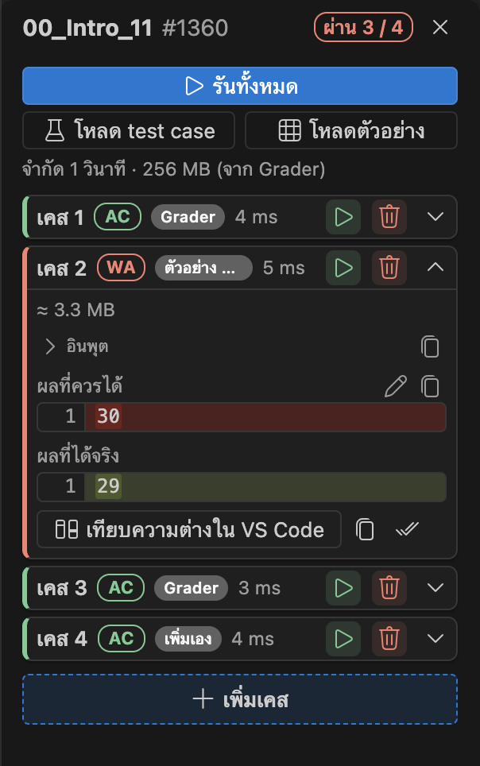

### การโหลด Test Case

ด้านบนของหน้า **ทดสอบ** (หรือเรียกผ่าน Command Palette) จะมีปุ่มโหลด 2 ปุ่มวางคู่กัน:

- **โหลด test case:** ดาวน์โหลด test case จาก API ของ Grader (สำหรับโจทย์ที่เปิดให้ดาวน์โหลด) โดยตัดเคสที่ซ้ำกันออกให้อัตโนมัติ และในโหมดโฟลเดอร์จะตัดบรรทัดสุดท้าย `KEY: …` ที่มีเฉพาะใน `main` ของเซิร์ฟเวอร์ออกให้ เพื่อให้รันทดสอบบนเครื่องแล้วตรงกับคำตอบจริง
- **โหลดตัวอย่าง:** อ่านตารางตัวอย่างอินพุตและเอาต์พุตจากไฟล์ PDF ของโจทย์โดยตรง ใช้ได้กับโจทย์ทุกข้อที่มีตารางตัวอย่างใน PDF แม้ว่าโจทย์นั้นจะไม่เปิดให้ดาวน์โหลด test case จาก Grader ก็ตาม

### การรันและตรวจสอบผลลัพธ์ในหน้าทดสอบ

- **รันทดสอบ (`Grader: รันทดสอบ (Run Tests)`):** บันทึกไฟล์ที่แก้ไข (เมื่อเปิด `cedtGrader.saveBeforeSubmit`) คอมไพล์โปรแกรมไว้ใน `<os.tmpdir()>/cedt-grader-bin/` (ข้ามการคอมไพล์ซ้ำหากโค้ดและ header ไม่ได้เปลี่ยน และสลับโฟลเดอร์อัตโนมัติหาก `/tmp` ติด `noexec`) แล้วรันทีละเคสพร้อมจัดการโปรเซสค้างให้สะอาด
- **เปิดหน้าทดสอบ (`Grader: เปิดหน้าทดสอบ (Open Tests)`):** เปิดแท็บ **ทดสอบ** ข้างโค้ดของคุณในกลุ่มเอดิเตอร์ที่ล็อกไว้:
  - แสดงสถานะ **ผ่าน (`AC`)**, **คำตอบผิด (`WA`)**, **เกินเวลา (`TLE`)**, **รันผิดพลาด (`RE`)** หรือ **คอมไพล์ไม่ผ่าน** พร้อมเวลาที่ใช้ (`ms`) และค่าประมาณหน่วยความจำสูงสุด (`MB` บน macOS และ Linux)
  - ดู **อินพุต**, **ผลที่ควรได้**, **ผลที่ได้จริง** แบบมีเลขบรรทัด และ **Stderr** (ข้อความใน stderr จะไม่ทำให้เคสนั้นตก หากโปรแกรมจบด้วย exit code `0` และ stdout ตรงตามคำตอบ)
  - ไฮไลต์จุดที่ข้อความต่างกันในแต่ละบรรทัด คลิก **เทียบความต่างใน VS Code** เพื่อเปิดหน้าต่าง Diff เต็มรูปแบบ หรือคลิก **ใช้ผลที่ได้จริงเป็นคำตอบ**
  - เพิ่มเคสของคุณเอง (**+ เพิ่มเคส**) แก้ไขอินพุต/ผลลัพธ์ได้โดยตรง (เมื่อแก้ไขเคสจาก Grader หรือตัวอย่าง PDF ป้ายกำกับจะเปลี่ยนเป็น `เพิ่มเอง`) ลากจัดลำดับเคส หรือกด <kbd>Alt</kbd>+<kbd>↑</kbd>/<kbd>↓</kbd> และกดรันเฉพาะเคสที่ต้องการได้
  - หากมีเฉพาะเคส `ตัวอย่าง PDF` ที่ไม่ผ่านติดกัน 2 ครั้ง ระบบจะแสดงคำแนะนำให้ลองเทียบกับไฟล์ PDF ของโจทย์ เผื่อกรณีตารางใน PDF มีรูปแบบซับซ้อนจนอ่านบรรทัดคลาดเคลื่อน

---

## 7. การอ่านโจทย์ (Problem Statements)

คลิกไอคอน PDF (**เปิดโจทย์** หรือคำสั่ง `Grader: เปิดโจทย์`) เพื่อเปิดอ่านโจทย์ในแท็บด้านข้างโค้ดของคุณ:

- **การควบคุม:** ซูมเข้า-ออกด้วยแทร็กแพดหรือกด <kbd>Cmd</kbd>/<kbd>Ctrl</kbd>+<kbd>+</kbd>/<kbd>-</kbd>, ปรับขนาดให้พอดีความกว้างด้วย <kbd>Cmd</kbd>/<kbd>Ctrl</kbd>+<kbd>0</kbd>, เปลี่ยนหน้า และค้นหาข้อความในโจทย์ด้วย <kbd>Cmd</kbd>/<kbd>Ctrl</kbd>+<kbd>F</kbd>
- **เปลี่ยนโจทย์ตามไฟล์ที่เปิดอยู่ (`cedtGrader.statementFollowsFile`):** เมื่อสลับไปดูไฟล์โค้ดของโจทย์ข้ออื่น แท็บโจทย์ที่เปิดอยู่จะเปลี่ยนเนื้อหาตามให้อัตโนมัติโดยไม่แย่งโฟกัส และปิดลงเมื่อสลับไปยังไฟล์ที่ไม่ได้เชื่อมกับโจทย์
- **แคชสำหรับอ่านออฟไลน์:** ไฟล์โจทย์ที่โหลดแล้วจะถูกเก็บไว้ใน `globalStorageUri` (สูงสุดตามค่า `cedtGrader.cacheMaxMB`) ทำให้เปิดอ่านซ้ำได้ทันทีโดยไม่ต้องโหลดใหม่

---

## 8. การส่งงาน ผลลัพธ์ และประวัติการส่ง

### การส่งงาน (Submitting)

- กดปุ่ม **Submit ไปยัง Grader** ในส่วน **โจทย์ปัจจุบัน** คลิกปุ่มบนแถบสถานะด้านล่าง (`$(cloud-upload) Submit ไปยัง Grader`) หรือเรียกคำสั่ง **Grader: ส่งไฟล์ปัจจุบัน (Submit)**
- หากเปิด `cedtGrader.confirmBeforeSubmit` (`true`) ไฟล์ที่จับคู่โจทย์ให้อัตโนมัติจะถามยืนยัน 1 ครั้งเหนือปุ่ม Submit และเมื่อกดยืนยันแล้วระบบจะบันทึกเป็น **คุณเลือกเอง** เพื่อไม่ถามซ้ำในการส่งครั้งถัดไป
- หากเปิด `cedtGrader.saveBeforeSubmit` (`true`) ระบบจะบันทึกไฟล์ลงดิสก์ก่อนส่งเสมอ

### ส่วนผลลัพธ์ (Result)

  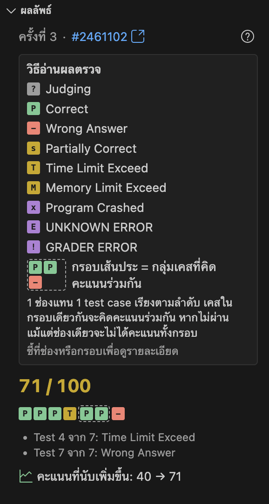

- แสดงสถานะขณะกำลังส่งและตรวจ (`กำลังส่ง…` → `กำลังตรวจ…`) และเปิดส่วนผลลัพธ์ขึ้นมาให้อัตโนมัติเมื่อตรวจเสร็จ (`cedtGrader.revealResultAfterSubmit`)
- แสดงผลตรวจรายเคสเป็นช่องสีตามลำดับ (`P` ผ่าน, `-` คำตอบผิด, `T` เกินเวลา, `X` โปรแกรมล่มหรือใช้หน่วยความจำเกิน, `S` ได้คะแนนบางส่วน) ส่วนกรอบเส้นประหมายถึงกลุ่มเคสที่คิดคะแนนร่วมกัน (หากผิดแม้แต่เคสเดียวจะไม่ได้คะแนนทั้งกรอบ) คลิกปุ่ม **?** เพื่อเปิด/ปิดคำอธิบายสัญลักษณ์

### ส่วนประวัติการส่ง (History)

  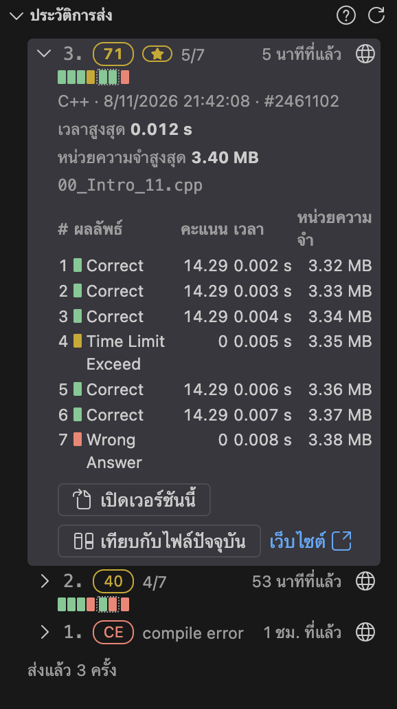

- แสดงรายการส่งทุกครั้งของโจทย์ข้อนั้น พร้อมเครื่องหมาย `★` บนการส่งที่เป็นคะแนนที่นับ (คะแนนสูงสุด)
- คลิกการส่งครั้งใดก็ได้เพื่อดูผลตรวจรายเคส เวลา หน่วยความจำ ข้อความจากคอมไพเลอร์ กด **เปิดเวอร์ชันนี้** เพื่อดูโค้ดที่ส่งในครั้งนั้น หรือกด **เทียบกับไฟล์ปัจจุบัน** เพื่อเปรียบเทียบโค้ดแบบเคียงข้างกัน

---

## 9. รายการโจทย์ ปุ่มหัวข้อ และตัวกรองแท็ก

  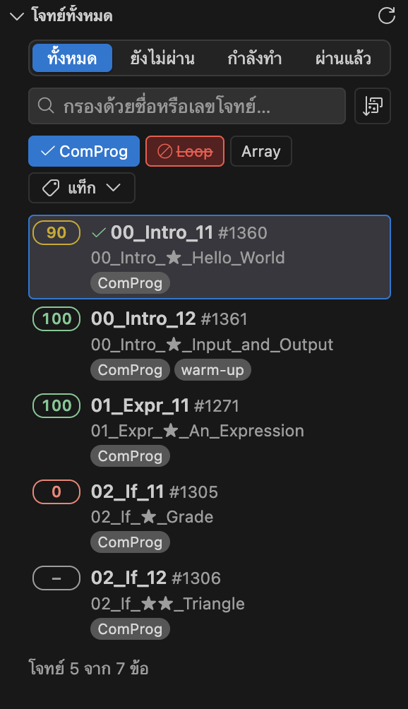

- **แท็บกรองตามสถานะ:** เลือกดู **ทั้งหมด**, **ยังไม่ผ่าน** (ยังไม่เคยส่ง หรือคะแนนสูงสุดต่ำกว่า 100), **กำลังทำ** หรือ **ผ่านแล้ว** (คะแนนสูงสุดตั้งแต่ 100 ขึ้นไป)
- **ปุ่มหัวข้อ 3 สถานะ (Topic Pills):** คลิกปุ่มหัวข้อครั้งที่ 1 เพื่อ**แสดงเฉพาะ**โจทย์ในหัวข้อนั้น (ปุ่มทึบพร้อมเครื่องหมาย `✓`), คลิกครั้งที่ 2 เพื่อ**ซ่อน**โจทย์ในหัวข้อนั้น (ปุ่มสีแดงขีดฆ่า) และคลิกครั้งที่ 3 เพื่อปิดตัวกรอง (ปรับให้คลิกครั้งแรกเป็นการซ่อนก่อนได้ที่ `cedtGrader.panel.topicClickOrder`: `hideFirst`)
- **ตัวกรองแท็ก (`แท็ก`):** กรองด้วยแท็กย่อยอื่น ๆ ของโจทย์ได้หลายแท็กพร้อมกัน โดยเลือกเงื่อนไขแบบ **แท็กใดก็ได้ (OR)** หรือ **ครบทุกแท็ก (AND)**
- **การค้นหาและเรียงลำดับ:** ค้นหาด้วยรหัสโจทย์ ชื่อเต็ม หรือเลข ID และเรียงลำดับตาม **ลำดับเริ่มต้น**, **ลำดับเริ่มต้น (ย้อนกลับ)**, **ชื่อ A–Z**, **ชื่อ Z–A**, **ส่งล่าสุด**, **คะแนน (น้อย → มาก)**, **คะแนน (มาก → น้อย)** หรือ **เปิดดูล่าสุด**
- **คำสั่งบนแถวโจทย์และการใช้แป้นพิมพ์:** คลิกที่แถวโจทย์เพื่อเปิดไฟล์ที่เชื่อมไว้ (หรือเลือกเชื่อมไฟล์ที่เปิดอยู่ สร้างไฟล์ใหม่ ค้นหาไฟล์ในโปรเจกต์ หรือเปิดโจทย์) ชี้เมาส์เพื่อกดไอคอนด่วน คลิกขวาเพื่อเปิดเมนู หรือเลื่อนด้วยปุ่มลูกศร <kbd>↑</kbd> / <kbd>↓</kbd> / <kbd>Home</kbd> / <kbd>End</kbd> และ <kbd>Tab</kbd>

---

## 10. ป้ายกำกับใน Explorer (Explorer Badges)

Grader Submit แสดงป้ายกำกับและสีสถานะท้ายชื่อไฟล์และโฟลเดอร์โจทย์ใน Explorer รวมถึงแท็บเอดิเตอร์โดยไม่ต้องส่งคำขอเครือข่ายเพิ่ม:

  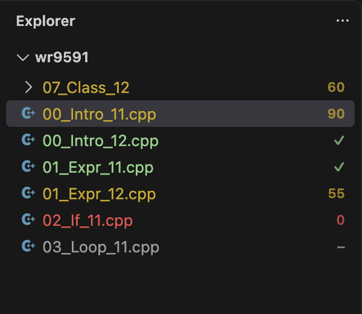

- **รูปแบบป้ายกำกับ (`cedtGrader.explorer.badge`):**
  - `score` (ค่าเริ่มต้น): แสดง `✓` เมื่อได้คะแนนเต็ม (`100`), แสดงตัวเลข `0`–`99` เมื่อเคยส่งแล้วแต่ยังไม่เต็ม และแสดง `–` เมื่อยังไม่เคยส่ง
  - `tag`: แสดงอักษรย่อ 2 ตัวแรกของแท็กหัวข้อแรกของโจทย์ (เช่น `GR`, `DP`) และแสดงแท็กทั้งหมดพร้อมคะแนนที่นับเมื่อชี้เมาส์
  - `off`: ปิดการแสดงป้ายกำกับใน Explorer
- **สีของป้ายกำกับและชื่อไฟล์ (`cedtGrader.explorer.colors`, ค่าเริ่มต้น `true`):** แสดงสีเขียว (`100`), สีเหลืองอำพัน (`1`–`99`), สีแดง (ส่งแล้วได้ `0`) หรือสีเทา (ยังไม่เคยส่ง) ในโหมด `score` หรือแสดงสีประจำหมวดหมู่ในโหมด `tag` (สามารถปรับแต่งสีเองได้ใน `workbench.colorCustomizations` ภายใต้ `cedtGrader.explorer.*`)

---

## 11. เอฟเฟกต์ฉลอง ถ้วยรางวัล และหน้าพักสายตา

ควบคุมด้วยสวิตช์หลัก `cedtGrader.fun.enabled` (ค่าเริ่มต้น `true`; หากเปลี่ยนเป็น `false` จะซ่อนส่วนถ้วยรางวัลและปิดการทำงานอัตโนมัติทั้งหมด แต่ยังสั่งรันคำสั่งจาก Command Palette เองได้):

  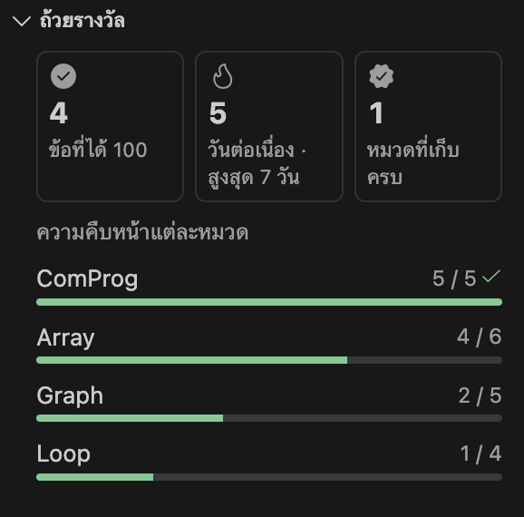

- **เอฟเฟกต์ฉลองเมื่อได้คะแนนเต็มครั้งแรก (`cedtGrader.fun.celebrate`):** เมื่อโจทย์ข้อนั้นได้คะแนนที่นับครบ `100` เป็นครั้งแรก (หรือผ่านครบทุกเคสสำหรับโจทย์คิดคะแนนรวมดิบและโจทย์ที่หักคะแนนคำใบ้) การ์ดผลลัพธ์จะเล่นแอนิเมชันวงแหวน โปรยกระดาษสี และแสดงข้อความปลดล็อกถ้วยรางวัล สามารถกดเล่นซ้ำได้ด้วยคำสั่ง **Grader: เล่นเอฟเฟกต์ฉลอง**
- **ส่วนถ้วยรางวัล (`Grader: ดูถ้วยรางวัล`):** สรุปจำนวน **ข้อที่ได้ 100**, จำนวน **วันต่อเนื่อง** ที่ทำโจทย์ (พร้อมสถิติสูงสุด), จำนวน **หมวดที่เก็บครบ** และแถบความคืบหน้าของแต่ละหมวดหมู่ในรายวิชา
- **การเตือนให้พักสายตา (`cedtGrader.fun.breakReminder`, `cedtGrader.fun.breakMinutes`):** เมื่อเขียนโค้ดต่อเนื่องครบ `90` นาที (นับจากการแก้ไขไฟล์ รันทดสอบ และส่งงาน หากหยุดพักเกิน 10 นาทีจะเริ่มนับใหม่) จะมีข้อความ `☕ พักไหม?` ปรากฏเงียบ ๆ บนแถบสถานะ และอีก 20–60 นาทีถัดมา — เฉพาะในจังหวะที่เหมาะแก่การพัก (เช่น เพิ่งได้คะแนนเต็ม รันผ่านทุกเคส หรือสลับไปทำโจทย์ข้อใหม่ โดยจะไม่เด้งถามตอนส่งไม่ผ่านหรือระหว่างสอบ และถามไม่เกินวันละ 2 ครั้ง) — จึงจะแสดงข้อความชวนให้กด **พักสักครู่**, **เตือนอีกใน 30 นาที** หรือ **วันนี้ไม่ต้องเตือน**
- **ฉากพักสายตาแบบโต้ตอบได้ 5 รูปแบบ (`cedtGrader.fun.breakScene`):** นำบรรทัดโค้ดที่คุณเปิดอยู่ (พร้อมสีตามไวยากรณ์จริง) มาสร้างเป็นหน้าพักสายตา 5 นาที:
  1. **โค้ดร่วงเป็นกองทราย (`sand`):** ตัวอักษรโค้ดร่วงลงมาเป็นกองทราย เลื่อนเมาส์เพื่อเกลี่ย กดค้างเพื่อตัก และปล่อยเมาส์เพื่อเท (`Grader: พักสายตาสักครู่: โค้ดร่วงเป็นกองทราย`)
  2. **โดนัท 3 มิติ (`donut3d`):** ตัวอักษรโค้ดหมุนเป็นรูปโดนัท 3 มิติ ลากเมาส์เพื่อหมุนดูได้ (`Grader: พักสายตาสักครู่: โดนัท 3 มิติ`)
  3. **โดนัทตัวอักษร (`donut2d`):** ตัวอักษรโค้ดหมุนเป็นโดนัท 2 มิติ (`Grader: พักสายตาสักครู่: โดนัทตัวอักษร`)
  4. **ฝึกหายใจ (`breathe`):** ตัวอักษรโค้ดเรียงเป็นวงกลมที่ขยายและหดตามจังหวะหายใจเข้า-ออกรอบละ 4 วินาที (`Grader: พักสายตาสักครู่: ฝึกหายใจ`)
  5. **ฝูงตัวอักษร (`swarm`):** ตัวอักษรโค้ดเคลื่อนที่ไหลวนตามการขยับเมาส์และคลิกเพื่อกระจายตัว (`Grader: พักสายตาสักครู่: ฝูงตัวอักษร`)

---

## 12. รูปลักษณ์ ภาษาที่แสดง และการจัดการข้อมูลแคช

- **รูปแบบการแสดงผล (`cedtGrader.panel.look`):** `subtle` (ค่าเริ่มต้น) มีการตรึงหัวข้อส่วนไว้ด้านบน การ์ดมีมิติ แอนิเมชันสั้น ๆ (เคารพค่า `prefers-reduced-motion` ของระบบ) และเมนูโปร่งแสงตามธีมของ VS Code หากต้องการรูปแบบเรียบที่ไม่มีแอนิเมชันสามารถเปลี่ยนเป็น `plain` ได้
- **ภาษาที่แสดง (`cedtGrader.displayLanguage`):** เลือกได้ระหว่าง `en` (English), `th` (ภาษาไทย) หรือ `auto` (ตามภาษาของ VS Code) เมื่อเปลี่ยนแล้วจะมีผลกับแผง Grader หน้าทดสอบ หน้าอ่านโจทย์ แถบสถานะ และข้อความแจ้งเตือนทันที
- **การล้างข้อมูลแคช (`Grader: ล้างข้อมูลแคช…`):** เรียกได้จาก Command Palette หรือเมนู **⋯** ของแผง โดยจะแสดงขนาดพื้นที่ที่ใช้และให้เลือกข้อมูลที่ต้องการล้างได้อย่างอิสระ:
  - **ไฟล์ที่ดาวน์โหลดไว้** (ไฟล์ PDF โจทย์, test case จาก Grader และรายละเอียดการส่ง — ติ๊กเลือกไว้เป็นค่าเริ่มต้น)
  - **รายการโจทย์ ประวัติการส่ง และการจับคู่อัตโนมัติที่จำไว้** (ติ๊กเลือกไว้เป็นค่าเริ่มต้น)
  - **test case ที่เพิ่มเอง** (ไม่ติ๊กเป็นค่าเริ่มต้น เพื่อป้องกันเคสที่สร้างเองหาย)
  - **การเชื่อมไฟล์กับโจทย์** (ไม่ติ๊กเป็นค่าเริ่มต้น)
  - **ข้อมูลเข้าสู่ระบบที่บันทึกไว้** (ไม่ติ๊กเป็นค่าเริ่มต้น)
  - **ไฟล์สำรองจากการนำเข้า test case** (`.prob.bak` แสดงเฉพาะเมื่อมีไฟล์สำรองอยู่)

---

## 13. การอัปเกรดจาก v1.0.0 และการล้างไฟล์ระบบเก่า

ในเวอร์ชัน `v1.0.0` ข้อมูลการเชื่อมโจทย์ถูกเก็บไว้ในไฟล์ `.cedt-grader.json` และ test case ถูกส่งออกไปเป็นไฟล์ `.cph/*.prob` หรือ `<problem>/tests/*.in|out` แต่ตั้งแต่เวอร์ชัน `v1.1.0` เป็นต้นไป:

1. **โอนย้ายข้อมูลให้อัตโนมัติ:** ทันทีที่เปิดโฟลเดอร์งานที่มีไฟล์ `.cedt-grader.json` หรือ `.cph/*.prob` ของ Grader นี้ ระบบจะคัดลอกการเชื่อมโจทย์และ test case ทั้งหมดเข้าไปเก็บในพื้นที่ซ่อน (`globalStorageUri`) ให้อัตโนมัติ
2. **ชวนย้ายไฟล์เก่าไปถังขยะ:** แผง Grader จะแสดงข้อความถามเพื่อย้ายไฟล์ `.cedt-grader.json`, `.cph/*.prob` (เฉพาะที่ตรงกับโจทย์บน Grader นี้ โดยไม่แตะต้องไฟล์ `.prob` ของเว็บโจทย์อื่น) และไฟล์ `<stem>.bin` ไปไว้ในถังขยะของระบบปฏิบัติการ
3. **สั่งล้างเองได้ทุกเมื่อ:** คุณสามารถเรียกคำสั่ง **Grader: ล้างไฟล์เก่า** (`cedtGrader.cleanUpOldFiles`) จาก Command Palette ได้ตลอดเวลา

---

## การแก้ปัญหาเบื้องต้น

  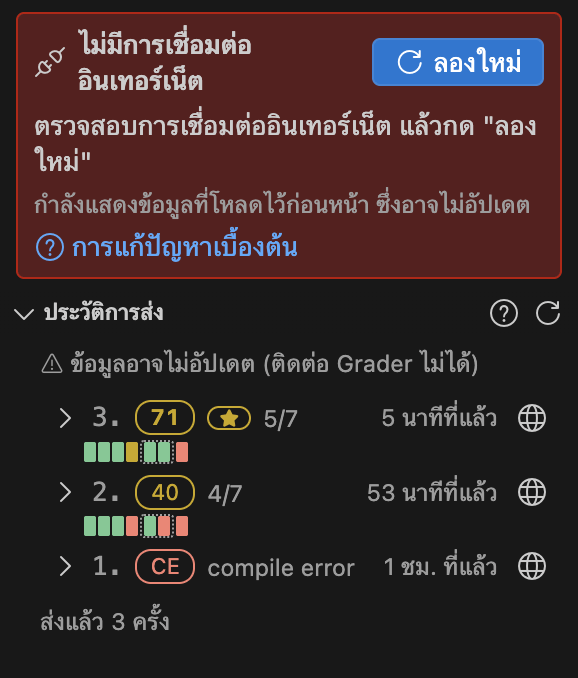

### ปัญหาการเข้าสู่ระบบและการตั้งค่าเซิร์ฟเวอร์

- **"ชื่อผู้ใช้หรือรหัสผ่านไม่ถูกต้อง"** — ตรวจสอบชื่อผู้ใช้และรหัสผ่านโดยลองเข้าสู่ระบบผ่านเว็บไซต์ Grader ทั้งนี้รหัสผ่านเดิมที่อาจจำไว้ผิดจะถูกล้างออกอัตโนมัติเพื่อให้คุณพิมพ์ใหม่ได้ทันที
- **"เข้าสู่ระบบผิดพลาดหลายครั้งเกินไป"** — เซิร์ฟเวอร์ `cafe-grader` จะบล็อกการเข้าสู่ระบบชั่วคราวเมื่อกรอกผิดติดกันหลายครั้ง (นับรวมทั้งบนหน้าเว็บและในส่วนขยาย) ให้รอสัก 2–3 นาทีแล้วค่อยกด **ลองใหม่**
- **"Grader ปฏิเสธการเข้าสู่ระบบ"** — บัญชีของคุณอาจถูกระงับหรือจำกัดให้ใช้งานได้เฉพาะเครือข่ายของมหาวิทยาลัย/ห้องสอบ โปรดสอบถามอาจารย์ผู้สอน
- **"เซิร์ฟเวอร์นี้ไม่ใช่ Grader ที่รองรับ"** — แสดงขึ้นเมื่อการตรวจสอบบรรทัด `เซิร์ฟเวอร์:` ในส่วน **บัญชี** พบว่า URL นั้นไม่ได้ตอบกลับเหมือนเซิร์ฟเวอร์ `cafe-grader-web` โปรดตรวจดู URL อีกครั้ง หรือคลิก **ใช้เซิร์ฟเวอร์เริ่มต้น**
- **"Grader … ส่งคำขอต่อไปยังที่อยู่อื่น … จึงหยุดไว้เพื่อความปลอดภัย"** — ระบบบล็อกการ redirect ข้ามโดเมนเพื่อปกป้องรหัสผ่านของคุณ หากเซิร์ฟเวอร์ของรายวิชาย้ายไปใช้โดเมนใหม่ ให้แก้ไขค่า `cedtGrader.baseUrl` ใน User Settings

### ปัญหาการจับคู่โจทย์และโหมดโฟลเดอร์

- **ระบบจับคู่โจทย์ไม่ตรงกับไฟล์ของฉัน** — คลิกช่องเลือกโจทย์ในส่วน **โจทย์ปัจจุบัน** แล้วเลือกโจทย์ที่ต้องการด้วยตัวเอง (จะถูกบันทึกเป็น **คุณเลือกเอง**) หรือคลิกปุ่ม **✕** เพื่อหยุดจับคู่อัตโนมัติสำหรับไฟล์นั้น
- **ต้องการเชื่อมโจทย์ที่มีหลายไฟล์ (`main.cpp` + `student.h`) ต้องทำอย่างไร?** — คลิกไอคอนโฟลเดอร์ (**เชื่อมทั้งโฟลเดอร์**) ในส่วน **โจทย์ปัจจุบัน** หรือเปิดโฟลเดอร์ที่แตกไฟล์มาแล้วเป็นโฟลเดอร์หลักของหน้าต่าง VS Code เมื่อมีทั้ง `main.cpp` และ `student.h` อยู่ข้างใน
- **"มี 2 ไฟล์ที่เชื่อมกับโจทย์นี้"** — คลิกปุ่ม **แสดง** ในแถบแจ้งเตือนเพื่อเปิดดูหรือยกเลิกการเชื่อมของอีกไฟล์ หรือคลิก **ปิด** เพื่อซ่อนข้อความแจ้งเตือนไว้จนกว่าไฟล์จะเปลี่ยน

### ปัญหาการรันทดสอบบนเครื่องและการโหลดตัวอย่าง

- **กด `รันทดสอบ` แล้วขึ้นว่าไม่พบคอมไพเลอร์** — ตรวจสอบว่าติดตั้งคอมไพเลอร์หรือตัวแปลภาษา (`g++`, `gcc`, `python3`, `javac`/`java`, `rustc`, `go`, `ghc`, `ruby`, `fpc`, `php`) และอยู่ใน `PATH` เรียบร้อยแล้ว หรือกำหนดพาธเต็มของเครื่องมือไว้ใน `cedtGrader.runner.compilerPaths`
- **รันบนเครื่องผ่านแต่ส่งตรวจบน Grader ไม่ผ่าน (หรือกลับกัน)** — ตัวรันบนเครื่องคอมไพล์ภาษา `C++` ด้วย `-std=gnu++17 -O2 -DEVAL` และตรวจคำตอบโดยไม่คิดช่องว่างท้ายบรรทัด ควรตรวจสอบตัวแปรที่ไม่ได้กำหนดค่าเริ่มต้น (uninitialized variables) การเข้าถึงอาเรย์เกินขอบเขต หรือความต่างของระบบปฏิบัติการ ทั้งนี้ค่าหน่วยความจำบน macOS/Linux เป็นค่าประมาณ (ส่วนบน Windows จะแสดง `—`)
- **กด `โหลดตัวอย่าง` แล้วขึ้นว่าไม่พบตารางตัวอย่าง หรือตัวอย่างที่โหลดมาดูเพี้ยน** — ระบบดึงข้อความจากตารางที่มีเส้นกรอบในไฟล์ PDF เท่านั้น หากเป็น PDF ที่สแกนเป็นรูปภาพจะไม่สามารถอ่านข้อความได้ และหากตารางมีหลายคอลัมน์หรือไม่มีเส้นแบ่งชัดเจนอาจทำให้ข้อความบางบรรทัดรวมกันได้ แนะนำให้เทียบกับไฟล์ PDF ของโจทย์และแก้ไขเคสในหน้า **ทดสอบ** ได้โดยตรง

### การรายงานข้อผิดพลาด (Crashes & Bug Reports)

- หากเกิดข้อผิดพลาดที่ไม่คาดคิด แผง Grader จะแสดงการ์ด **Grader Submit เกิดข้อผิดพลาด** พร้อมข้อความรายงานที่ตัดโทเค็น รหัสผ่าน และพาธส่วนตัวออกทั้งหมดแล้ว คุณสามารถคลิก **รายงานบน GitHub** เพื่อเปิดหน้าสร้าง Issue พร้อมข้อมูลดังกล่าวได้ทันที หรือดูช่องทางเพิ่มเติมได้ใน [**`SUPPORT.md`**](SUPPORT.md)
